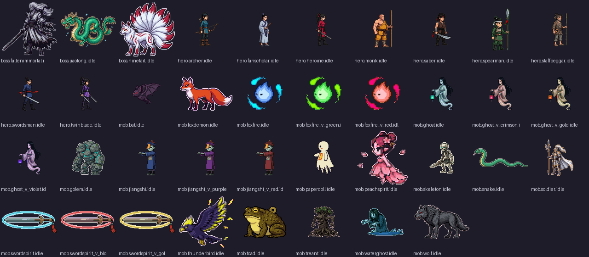
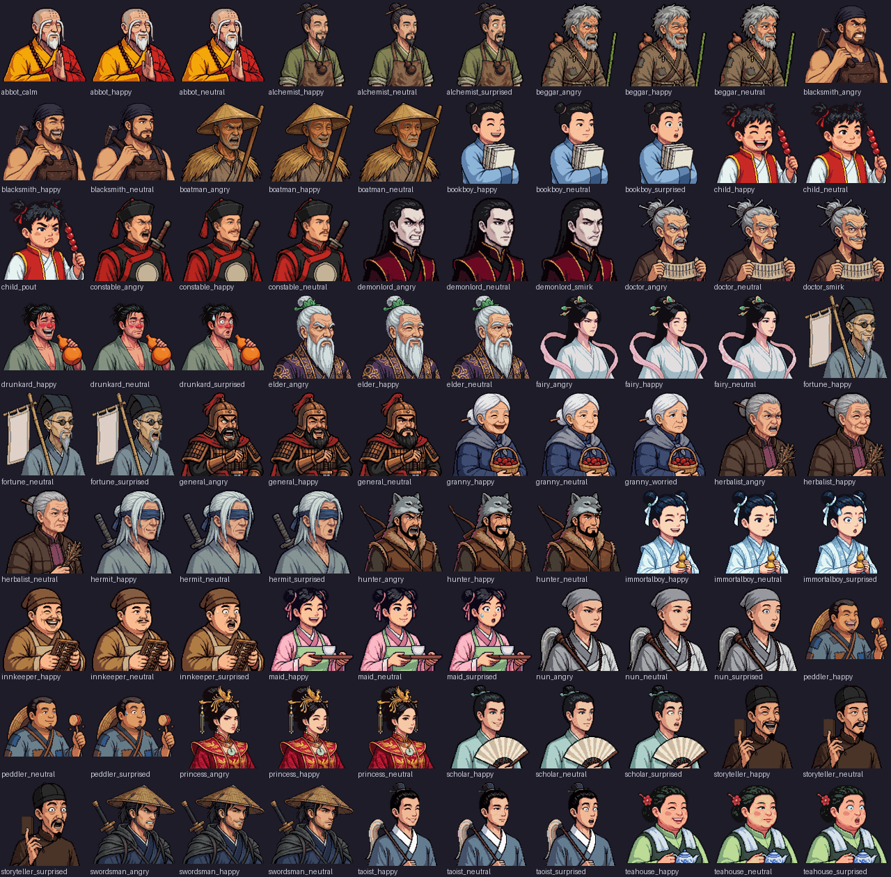
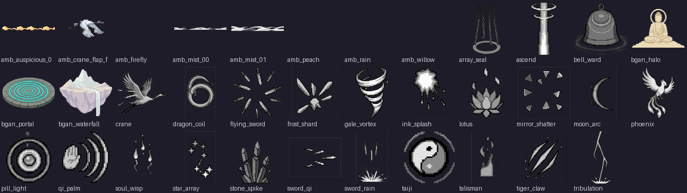
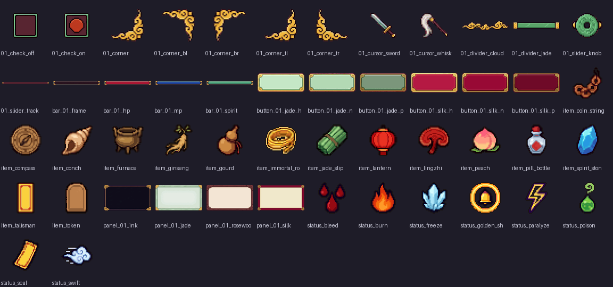
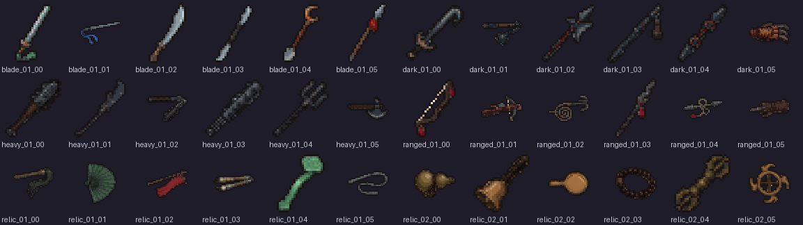

# Art library

> Generated by `npm run design` from `src/`. Do not edit; change the data and regenerate.

Contact sheets of everything in the manifest (217 animation sheets, 35 fx, 90 portraits, 50 ui, 36 icons). Licensing: `docs/ASSET_LICENSE_AUDIT.md`.

## sheets-idle

## portraits

## fx

## ui

## icons

