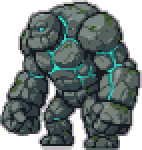

# Bosses

> Generated by `npm run design` from `src/`. Do not edit; change the data and regenerate.

Each boss draws moves from a per-phase pool; every damaging move is telegraphed (see `tests/boss.test.ts`).

## Fallen Sword Immortal (`warden`)

| HP | ATK | DEF | speed | XP | stones | home | minion zone | quest | phase 2 / 3 at |
|---|---|---|---|---|---|---|---|---|---|
| 6600 | 30 | 9 | 36 | 600 | 90–140 | lair | lair | warden | 0.66 / 0.33 |

Kit: **P1** slam, sweep · **P2** slam, sweep, rain, summon · **P3** rain, teleport, ring, sweep, slam

Drops: jade-sword (100%), immortal-mantle (100%), qi-pill (100%)

| move | parameters |
|---|---|
| slam | radius 56, windup 0.9, recover 0.5, cooldown 4, damageMult 1.8, triggerRange 90 |
| sweep | range 84, halfAngle 0.95, windup 0.75, recover 0.5, cooldown 3.2, damageMult 1.5, triggerRange 84 |
| rain | count 6, radius 30, spread 120, windup 0.5, delay 1, recover 0.4, cooldown 6, damageMult 1.2 |
| teleport | windup 0.8, recover 0.5, cooldown 9, behind 46, radius 50, damageMult 1.6 |
| summon | windup 0.8, cooldown 14, count 2, maxMinions 4, minionType swordspirit |
| ring | windup 0.8, cooldown 7, projectiles 10, damageMult 1 |

## Nine-Tailed Fox Spirit (`ninetail`)

| HP | ATK | DEF | speed | XP | stones | home | minion zone | quest | phase 2 / 3 at |
|---|---|---|---|---|---|---|---|---|---|
| 3200 | 22 | 6 | 48 | 300 | 55–80 | den | grove | fox | 0.66 / 0.33 |

Kit: **P1** sweep, charge · **P2** charge, rain, summon, sweep · **P3** teleport, charge, ring, rain, sweep

Drops: spirit-saber (100%), qi-pill (100%), spirit-ring (50%)

| move | parameters |
|---|---|
| sweep | range 74, halfAngle 1.25, windup 0.6, recover 0.4, cooldown 2.6, damageMult 1.3, triggerRange 80 |
| charge | windup 0.7, duration 0.5, speed 300, width 20, recover 0.7, cooldown 4.5, damageMult 1.5, minRange 12, maxRange 230 |
| rain | count 5, radius 28, spread 100, windup 0.4, delay 0.9, recover 0.4, cooldown 6, damageMult 1.1 |
| teleport | windup 0.7, recover 0.4, cooldown 8, behind 40, radius 46, damageMult 1.4 |
| summon | windup 0.7, cooldown 12, count 3, maxMinions 5, minionType foxfire |
| ring | windup 0.7, cooldown 6, projectiles 12, damageMult 0.9 |

## Jiao Dragon of the Mist Pool (`jiaolong`)

| HP | ATK | DEF | speed | XP | stones | home | minion zone | quest | phase 2 / 3 at |
|---|---|---|---|---|---|---|---|---|---|
| 7400 | 34 | 10 | 42 | 700 | 120–180 | pool | marsh | jiaolong | 0.66 / 0.33 |

Kit: **P1** sweep, rain · **P2** sweep, charge, ring, summon · **P3** rain, ring, charge, slam, sweep

Drops: dragon-pearl (100%), dragon-scale-robe (60%), qi-pill (100%)

| move | parameters |
|---|---|
| slam | radius 50, windup 0.85, recover 0.5, cooldown 4.2, damageMult 1.6, triggerRange 84 |
| sweep | range 92, halfAngle 1.1, windup 0.65, recover 0.45, cooldown 3, damageMult 1.4, triggerRange 90 |
| charge | windup 0.75, duration 0.55, speed 280, width 24, recover 0.7, cooldown 5, damageMult 1.5, minRange 14, maxRange 240 |
| rain | count 7, radius 28, spread 110, windup 0.5, delay 0.95, recover 0.4, cooldown 5.5, damageMult 1.1 |
| summon | windup 0.75, cooldown 13, count 2, maxMinions 4, minionType waterghost |
| ring | windup 0.75, cooldown 6.5, projectiles 12, damageMult 0.95 |

## Corpse King of the Ashen Barrow (`corpseking`)

| HP | ATK | DEF | speed | XP | stones | home | minion zone | quest | phase 2 / 3 at |
|---|---|---|---|---|---|---|---|---|---|
| 11000 | 44 | 12 | 44 | 800 | 160–230 | barrow | barrow | barrow-rites | 0.66 / 0.33 |

Kit: **P1** slam, charge · **P2** charge, sweep, summon, slam · **P3** charge, ring, summon, slam, sweep

Drops: barrow-ward (100%), greater-hp-potion (100%), qi-pill (100%)

| move | parameters |
|---|---|
| slam | radius 58, windup 0.85, recover 0.5, cooldown 4, damageMult 1.7, triggerRange 90 |
| sweep | range 90, halfAngle 1, windup 0.7, recover 0.45, cooldown 3, damageMult 1.4, triggerRange 88 |
| charge | windup 0.7, duration 0.55, speed 300, width 26, recover 0.7, cooldown 4.6, damageMult 1.6, minRange 14, maxRange 250 |
| summon | windup 0.75, cooldown 12, count 3, maxMinions 5, minionType bloodjiangshi |
| ring | windup 0.75, cooldown 6.5, projectiles 12, damageMult 0.95 |

## Crystal Colossus (`crystalcolossus`)

| HP | ATK | DEF | speed | XP | stones | home | minion zone | quest | phase 2 / 3 at |
|---|---|---|---|---|---|---|---|---|---|
| 11500 | 50 | 18 | 32 | 1000 | 200–280 | hollow | crystal | hollow-heart | 0.66 / 0.33 |

Kit: **P1** slam, sweep · **P2** slam, rain, summon, sweep · **P3** rain, ring, slam, sweep, summon

Drops: crystal-saber (100%), crystal-robe (70%), greater-mana-potion (100%)

| move | parameters |
|---|---|
| slam | radius 66, windup 1, recover 0.6, cooldown 4.2, damageMult 1.9, triggerRange 100 |
| sweep | range 100, halfAngle 1.1, windup 0.8, recover 0.5, cooldown 3.4, damageMult 1.5, triggerRange 96 |
| rain | count 8, radius 30, spread 130, windup 0.5, delay 1, recover 0.4, cooldown 5.5, damageMult 1.2 |
| summon | windup 0.8, cooldown 14, count 2, maxMinions 3, minionType prismghost |
| ring | windup 0.8, cooldown 6, projectiles 14, damageMult 1 |

## Sundered Sovereign (`sovereign`)

| HP | ATK | DEF | speed | XP | stones | home | minion zone | quest | phase 2 / 3 at |
|---|---|---|---|---|---|---|---|---|---|
| 21000 | 58 | 20 | 42 | 1700 | 300–420 | summit | summit | sundered-sovereign | 0.66 / 0.33 |

Kit: **P1** slam, sweep, charge · **P2** slam, rain, summon, teleport, sweep · **P3** rain, teleport, ring, charge, slam, sweep

Drops: sovereign-blade (100%), sky-seal (100%), qi-pill (100%)

| move | parameters |
|---|---|
| slam | radius 62, windup 0.85, recover 0.45, cooldown 3.8, damageMult 1.8, triggerRange 96 |
| sweep | range 96, halfAngle 1, windup 0.7, recover 0.45, cooldown 3, damageMult 1.5, triggerRange 92 |
| charge | windup 0.7, duration 0.5, speed 320, width 24, recover 0.6, cooldown 5, damageMult 1.6, minRange 14, maxRange 260 |
| rain | count 8, radius 30, spread 130, windup 0.5, delay 0.95, recover 0.4, cooldown 5.5, damageMult 1.2 |
| teleport | windup 0.75, recover 0.45, cooldown 8, behind 46, radius 52, damageMult 1.7 |
| summon | windup 0.8, cooldown 13, count 3, maxMinions 5, minionType prismghost |
| ring | windup 0.75, cooldown 6, projectiles 14, damageMult 1 |

## Moonfang Alpha (`alphawolf`)

| HP | ATK | DEF | speed | XP | stones | home | minion zone | quest | phase 2 / 3 at |
|---|---|---|---|---|---|---|---|---|---|
| 4200 | 22 | 6 | 56 | 380 | 60–90 | wolfden | wolfden | – | 0.66 / 0.33 |

Kit: **P1** sweep, charge · **P2** charge, summon, sweep · **P3** charge, ring, summon, sweep

Drops: steel-blade (100%), hp-potion (100%)

| move | parameters |
|---|---|
| sweep | range 70, halfAngle 1.1, windup 0.6, recover 0.4, cooldown 2.8, damageMult 1.3, triggerRange 76 |
| charge | windup 0.65, duration 0.5, speed 290, width 22, recover 0.7, cooldown 4.2, damageMult 1.5, minRange 12, maxRange 230 |
| summon | windup 0.7, cooldown 11, count 3, maxMinions 5, minionType wolf |
| ring | windup 0.7, cooldown 7, projectiles 10, damageMult 0.9 |

## Shade of the Sword Disciple (`swordshade`)

| HP | ATK | DEF | speed | XP | stones | home | minion zone | quest | phase 2 / 3 at |
|---|---|---|---|---|---|---|---|---|---|
| 6800 | 30 | 9 | 40 | 620 | 100–150 | swordsanctum | swordsanctum | – | 0.66 / 0.33 |

Kit: **P1** slam, sweep · **P2** slam, sweep, ring · **P3** teleport, ring, sweep, slam

Drops: spirit-silk (100%), qi-pill (100%)

| move | parameters |
|---|---|
| slam | radius 52, windup 0.85, recover 0.5, cooldown 4, damageMult 1.7, triggerRange 86 |
| sweep | range 80, halfAngle 0.95, windup 0.7, recover 0.5, cooldown 3.2, damageMult 1.5, triggerRange 80 |
| teleport | windup 0.8, recover 0.5, cooldown 9, behind 44, radius 48, damageMult 1.5 |
| ring | windup 0.8, cooldown 7, projectiles 12, damageMult 1 |
