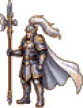
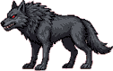
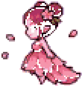

# Enemies

> Generated by `npm run design` from `src/`. Do not edit; change the data and regenerate.

109 enemy types. "Scaled" is the final stat in each zone (base × HP_BASE 4 × zone tier); elites ×2.8 HP, ×1.4 ATK, ×3 XP.

|  | id | name | behaviour | zones | base HP/ATK/DEF | speed | aggro | windup | XP | stones | drops |
|---|---|---|---|---|---|---|---|---|---|---|---|
|  | wolf | Spirit Wolf | rusher | bamboo, wolfden | 40/8/1 | 58 | 110 | 0.3 | 12 | 1–3 | hp-potion 12% |
|  | snake | Jade Serpent | rusher | bamboo, marsh, lake, wolfden | 28/7/0 | 44 | 90 | 0.28 | 9 | 1–2 | hp-potion 10% |
|  | foxfire | Foxfire Wisp | caster | bamboo, lake, wolfden | 22/10/0 | 40 | 130 | – | 16 | 2–4 | mana-potion 25% |
|  | treant | Elder Treant | charger | bamboo | 110/13/5 | 26 | 100 | 0.7 | 35 | 4–8 | qi-pill 30%, hp-potion 40% |
|  | toad | Marsh Toad | rusher | marsh, lake, s1-pearlgrotto | 64/9/3 | 30 | 90 | 0.42 | 18 | 2–4 | hp-potion 20% |
|  | waterghost | Drowned Ghost | rusher | marsh, lake, s1-pearlgrotto | 34/9/0 | 36 | 120 | 0.3 | 17 | 2–4 | mana-potion 25% |
|  | ghost | Lantern Ghost | caster | marsh | 26/11/0 | 38 | 130 | – | 20 | 2–5 | mana-potion 30%, qi-pill 10% |
|  | peachspirit | Peach Spirit | caster | grove | 30/10/0 | 36 | 130 | – | 20 | 2–5 | mana-potion 30%, qi-pill 12% |
|  | bat | Cave Bat | rusher | grove, wolfden | 26/6/0 | 78 | 130 | 0.24 | 8 | 1–2 | – |
|  | paperdoll | Paper Doll | rusher | grove, swordsanctum | 26/8/0 | 52 | 100 | 0.3 | 11 | 1–2 | hp-potion 10% |
|  | swordspirit | Sword Spirit | charger | grove, cliffs, swordsanctum | 34/12/1 | 40 | 130 | 0.45 | 24 | 3–6 | qi-pill 20% |
|  | thunderbird | Thunder Bird | caster | grove, cliffs, s1-stormroost | 40/13/1 | 44 | 150 | – | 34 | 4–8 | qi-pill 30%, mana-potion 30% |
|  | skeleton | Bone Soldier | rusher | ruins, swordsanctum | 46/10/2 | 42 | 110 | 0.3 | 20 | 2–5 | hp-potion 20% |
|  | jiangshi | Jiangshi | charger | ruins, cliffs | 62/13/3 | 34 | 110 | 0.6 | 30 | 3–7 | qi-pill 25% |
|  | soldier | Fallen Guard | rusher | ruins, swordsanctum | 56/11/4 | 40 | 110 | 0.36 | 24 | 3–6 | hp-potion 25% |
|  | golem | Stone Golem | charger | ruins, swordsanctum | 110/16/8 | 24 | 100 | 0.8 | 48 | 6–12 | qi-pill 35%, hp-potion 40% |
|  | frostwolf | Frost Wolf | rusher | frostpass, tundra, s2-rimeheart | 52/11/2 | 66 | 120 | 0.28 | 20 | 3–6 | greater-hp-potion 8%, hp-potion 15% |
|  | icesnake | Rime Serpent | rusher | frostpass, glaciermaw, s2-rimeheart, s2-wyrmden | 38/11/1 | 50 | 100 | 0.26 | 16 | 2–5 | hp-potion 12% |
|  | frostwisp | Frost Wisp | caster | frostpass, crystal, s2-rimeheart | 48/14/0 | 42 | 140 | – | 24 | 3–6 | greater-mana-potion 10%, mana-potion 25% |
|  | rimebat | Rime Bat | rusher | frostpass, crystal, glaciermaw, tundra, s2-rimeheart | 34/9/0 | 86 | 140 | 0.22 | 14 | 2–4 | – |
|  | snowtreant | Hoarfrost Treant | charger | frostpass, tundra | 150/18/7 | 28 | 110 | 0.7 | 55 | 8–14 | qi-pill 35%, greater-hp-potion 20% |
|  | crystalgolem | Crystal Golem | charger | crystal, s2-mirrorvault | 120/17/11 | 26 | 110 | 0.8 | 70 | 10–18 | qi-pill 40%, greater-mana-potion 20% |
|  | prismghost | Prism Ghost | caster | crystal, barrow, glaciermaw, s2-mirrorvault, s2-wyrmden | 42/16/0 | 40 | 140 | – | 30 | 4–8 | greater-mana-potion 12%, qi-pill 15% |
|  | shardbird | Shard Bird | caster | crystal | 54/17/1 | 48 | 160 | – | 40 | 6–11 | qi-pill 30%, greater-mana-potion 15% |
|  | ashskeleton | Ash Soldier | rusher | barrow, s2-gravewind | 66/15/4 | 46 | 120 | 0.3 | 30 | 4–8 | greater-hp-potion 10%, hp-potion 20% |
|  | bloodjiangshi | Blood Jiangshi | charger | barrow, s2-gravewind | 96/20/5 | 38 | 120 | 0.55 | 46 | 6–12 | qi-pill 30%, greater-hp-potion 15% |
|  | ashguard | Barrow Guard | rusher | barrow, s2-gravewind | 84/14/6 | 42 | 120 | 0.34 | 36 | 5–10 | greater-hp-potion 12%, hp-potion 25% |
|  | s1-pearlwisp | Pearl Wisp | caster | lake, s1-pearlgrotto | 26/11/0 | 40 | 130 | – | 18 | 2–4 | mana-potion 25%, s1-mist-tonic 8% |
|  | s1-driftwood | Driftwood Treant | charger | lake, s1-pearlgrotto | 90/12/4 | 26 | 100 | 0.7 | 30 | 3–7 | hp-potion 35%, qi-pill 25% |
|  | s1-tidemaiden | Tide Maiden | caster | lake, s1-pearlgrotto | 30/12/0 | 38 | 130 | – | 22 | 2–5 | mana-potion 30%, s1-lotus-draught 8% |
|  | s1-stormhawk | Storm Hawk | caster | cliffs, s1-stormroost | 42/14/1 | 46 | 150 | – | 36 | 4–8 | qi-pill 30%, mana-potion 25% |
|  | s1-basaltgolem | Basalt Golem | charger | cliffs, s1-stormroost | 120/17/9 | 24 | 100 | 0.8 | 52 | 6–12 | qi-pill 35%, hp-potion 40% |
|  | s1-cragbat | Crag Bat | rusher | cliffs, s1-stormroost | 28/7/0 | 84 | 130 | 0.24 | 10 | 1–3 | – |
|  | s1-thunderimp | Thunder Talisman | charger | cliffs, s1-stormroost | 30/12/0 | 52 | 110 | 0.4 | 20 | 2–5 | qi-pill 15%, s1-storm-pill 8% |
|  | s1-direwolf | Moonfang Dire Wolf | rusher | wolfden | 52/9/2 | 62 | 120 | 0.3 | 16 | 2–4 | hp-potion 15% |
|  | s2-glacierwolf | Glacier Wolf | rusher | tundra, s2-rimeheart | 56/11/2 | 68 | 120 | 0.28 | 22 | 3–6 | greater-hp-potion 8%, hp-potion 15% |
|  | s2-howlwraith | Howling Wraith | caster | tundra | 44/14/0 | 40 | 140 | – | 28 | 4–8 | greater-mana-potion 10%, mana-potion 25% |
|  | s2-blizzardhawk | Blizzard Hawk | caster | tundra | 54/16/1 | 50 | 160 | – | 38 | 6–11 | qi-pill 30%, greater-mana-potion 15% |
|  | s2-mawserpent | Maw Serpent | rusher | glaciermaw, s2-wyrmden | 48/12/2 | 52 | 110 | 0.26 | 22 | 3–6 | hp-potion 12% |
|  | s2-aurorawisp | Aurora Wisp | caster | glaciermaw, s2-wyrmden | 46/15/0 | 42 | 140 | – | 26 | 3–7 | greater-mana-potion 10%, s2-aurora-draught 4% |
|  | s2-glacierbrute | Glacier Brute | charger | glaciermaw, s2-wyrmden | 135/18/10 | 26 | 110 | 0.8 | 62 | 9–16 | qi-pill 40%, greater-hp-potion 20% |
|  | s2-frozencorpse | Frozen Corpse | charger | s2-gravewind | 100/20/6 | 36 | 120 | 0.55 | 48 | 6–12 | qi-pill 30%, s2-frostlotus-pill 5% |
|  | s2-tombwraith | Tomb Wraith | caster | s2-gravewind | 46/17/0 | 40 | 140 | – | 32 | 4–8 | greater-mana-potion 12%, qi-pill 15% |
|  | s2-mirrorspirit | Mirror Blade Spirit | charger | s2-mirrorvault | 50/16/2 | 44 | 140 | 0.4 | 34 | 4–9 | qi-pill 20%, greater-mana-potion 10% |
|  | s2-glasspuppet | Glass Puppet | rusher | s2-mirrorvault | 44/13/1 | 56 | 110 | 0.28 | 22 | 3–6 | greater-hp-potion 8% |
|  | s2-rimesentinel | Rime Sentinel | rusher | s2-mirrorvault | 90/15/7 | 40 | 120 | 0.34 | 38 | 5–10 | greater-hp-potion 12%, hp-potion 25% |
|  | sandviper | Sand Viper | rusher | dunes, oasis, ember-burrow | 47/12/1 | 58 | 115 | 0.26 | 22 | 3–6 | ember-viper-fang 40%, greater-hp-potion 8% |
|  | dunejackal | Dune Jackal | rusher | dunes, oasis | 56/13/2 | 72 | 115 | 0.28 | 26 | 3–7 | greater-hp-potion 10%, hp-potion 20% |
|  | glassscorpion | Glass Scorpion | rusher | dunes, canyon, ember-burrow | 74/14/6 | 40 | 115 | 0.4 | 34 | 5–10 | ember-glass-shard 35%, greater-hp-potion 10% |
|  | dustwisp | Dust Wisp | caster | dunes, ember-burrow | 44/15/0 | 42 | 145 | – | 28 | 4–8 | greater-mana-potion 15% |
|  | cactuswarden | Cactus Warden | charger | dunes, oasis, ember-burrow | 120/18/6 | 28 | 115 | 0.7 | 56 | 8–14 | qi-pill 35%, ember-hp-potion 8% |
|  | reedtoad | Reed Toad | rusher | oasis | 84/14/4 | 32 | 115 | 0.4 | 32 | 4–9 | greater-hp-potion 14% |
|  | drownedcaravaneer | Drowned Caravaneer | rusher | oasis | 56/14/1 | 38 | 115 | 0.3 | 30 | 4–8 | greater-mana-potion 14%, ember-glass-shard 15% |
|  | oasisnymph | Oasis Nymph | caster | oasis | 52/15/0 | 38 | 140 | – | 32 | 4–9 | greater-mana-potion 18%, qi-pill 20% |
|  | claygolem | Clay Golem | charger | canyon | 130/18/9 | 26 | 115 | 0.8 | 70 | 10–18 | qi-pill 40%, ember-hp-potion 10% |
|  | ashroc | Ash Roc | caster | canyon, saltflats | 58/17/0 | 48 | 165 | – | 42 | 6–12 | ember-roc-feather 45%, greater-mana-potion 15% |
|  | duneraider | Dune Raider | rusher | canyon | 84/15/6 | 44 | 115 | 0.34 | 38 | 6–12 | greater-hp-potion 16%, ember-hp-potion 5% |
|  | cindermoth | Cinder Moth | rusher | canyon, magmarift, ember-mine | 46/11/0 | 88 | 140 | 0.22 | 20 | 3–6 | hp-potion 12% |
|  | saltghoul | Salt Ghoul | charger | saltflats | 100/20/5 | 36 | 115 | 0.55 | 52 | 7–14 | qi-pill 30%, ember-hp-potion 8% |
|  | mirageghost | Mirage Ghost | caster | saltflats, suntemple | 50/17/0 | 40 | 150 | – | 36 | 5–10 | ember-mana-potion 7%, greater-mana-potion 18% |
|  | brinecrawler | Brine Crawler | rusher | saltflats | 66/16/3 | 50 | 115 | 0.28 | 34 | 5–10 | greater-hp-potion 12% |
|  | saltsoldier | Salt-Preserved Soldier | rusher | saltflats | 88/16/6 | 46 | 115 | 0.3 | 40 | 6–12 | greater-hp-potion 14%, ember-hp-potion 5% |
|  | magmasprite | Magma Sprite | caster | magmarift, ember-mine | 54/19/0 | 44 | 150 | – | 40 | 6–12 | ember-mana-potion 10%, greater-mana-potion 18% |
|  | obsidiangolem | Obsidian Golem | charger | magmarift, ember-mine | 150/20/12 | 26 | 115 | 0.8 | 84 | 12–22 | ember-obsidian-shard 50%, ember-qi-pill 12% |
|  | slagtoad | Slag Toad | rusher | magmarift, ember-mine | 100/17/6 | 34 | 115 | 0.4 | 44 | 7–14 | ember-hp-potion 10%, greater-hp-potion 15% |
|  | cinderhound | Cinder Hound | rusher | magmarift, ember-mine | 72/15/3 | 76 | 115 | 0.26 | 42 | 6–12 | ember-hp-potion 8%, greater-hp-potion 15% |
|  | mummy | Gilded Mummy | rusher | suntemple | 104/14/8 | 40 | 115 | 0.34 | 52 | 8–16 | ember-sun-tablet 30%, ember-hp-potion 10% |
|  | sunhusk | Sun-Cursed Husk | charger | suntemple | 116/18/7 | 38 | 115 | 0.55 | 62 | 9–17 | ember-sun-tablet 25%, ember-qi-pill 12% |
|  | templeguard | Temple Sentinel | rusher | suntemple | 108/13/11 | 42 | 115 | 0.36 | 58 | 8–16 | ember-sun-tablet 25%, ember-hp-potion 10% |
|  | sunblade | Sun Blade Spirit | charger | suntemple | 62/20/3 | 42 | 115 | 0.45 | 50 | 7–14 | ember-qi-pill 15% |
|  | vaultblade | Furnace Blade Spirit | charger | ember-vault | 70/22/4 | 44 | 115 | 0.42 | 54 | 8–15 | ember-qi-pill 15% |
|  | homunculus | Alchemy Homunculus | rusher | ember-vault | 76/15/4 | 54 | 115 | 0.28 | 44 | 6–12 | ember-hp-potion 10% |
|  | vaultwisp | Vapour Wisp | caster | ember-vault | 56/20/0 | 44 | 150 | – | 46 | 7–13 | ember-mana-potion 12% |
|  | bronzeguardian | Bronze Guardian | charger | ember-vault | 150/17/13 | 26 | 115 | 0.8 | 90 | 13–24 | ember-qi-pill 20%, ember-obsidian-shard 20% |
|  | glasswormling | Glass Wormling | rusher | ember-burrow | 70/15/3 | 50 | 115 | 0.3 | 34 | 5–10 | ember-glass-shard 30% |
|  | jadesentinel | Jade Sentinel | rusher | orchard, mirror, stair, storm, jademine | 62/21/8 | 42 | 120 | 0.34 | 40 | 6–12 | jade-hp-potion 8%, jade-ore 12% |
|  | jadecolossus | Jade Colossus | charger | stair, library, jademine, scrollvault | 120/28/16 | 26 | 110 | 0.8 | 90 | 14–26 | jade-ore 40%, jade-pill 12% |
|  | stormcrane | Storm Crane | caster | storm, crane | 52/22/2 | 46 | 160 | – | 60 | 10–18 | jade-feather 35%, jade-mana-potion 10% |
|  | cloudserpent | Cloud Serpent | rusher | orchard, mirror, storm, cloudhollow | 64/16/2 | 54 | 110 | 0.26 | 32 | 4–9 | hp-potion 20% |
|  | scrollwraith | Scroll Wraith | rusher | library, scrollvault | 46/19/1 | 56 | 110 | 0.28 | 38 | 5–10 | jade-slip-scrap 40%, jade-mana-potion 8% |
|  | inkwisp | Ink Wisp | caster | library, scrollvault | 58/24/0 | 42 | 150 | – | 55 | 8–15 | jade-slip-scrap 30%, jade-mana-potion 14% |
|  | celestialguard | Celestial Guard | rusher | stair, crane, library, scrollvault, moonpalace | 92/20/14 | 40 | 120 | 0.38 | 70 | 10–20 | jade-hp-potion 12%, jade-pill 8% |
|  | skyblade | Heavenly Sword Spirit | charger | stair, storm, crane, jademine | 56/24/4 | 44 | 140 | 0.42 | 52 | 8–14 | jade-pill 10% |
|  | blossomsprite | Blossom Sprite | caster | orchard, mirror, cloudhollow | 46/20/0 | 38 | 140 | – | 42 | 5–10 | jade-peach 30%, jade-mana-potion 8% |
|  | blossomtreant | Blossom Treant | charger | orchard | 130/27/9 | 28 | 110 | 0.7 | 78 | 12–22 | jade-peach 50%, jade-hp-potion 14% |
|  | mirrorwraith | Mirror Wraith | caster | mirror, crane, moonpalace | 50/21/0 | 40 | 150 | – | 46 | 6–12 | jade-mana-potion 12% |
|  | cloudhound | Cloud Hound | rusher | orchard, mirror, stair, crane, cloudhollow | 76/17/3 | 72 | 130 | 0.26 | 36 | 5–10 | jade-hp-potion 6% |
|  | stormhound | Thunder Hound | charger | storm, cloudhollow | 70/25/4 | 52 | 140 | 0.5 | 58 | 8–15 | jade-hp-potion 10% |
|  | veinbat | Jadevein Bat | rusher | cloudhollow, jademine | 62/13/0 | 90 | 140 | 0.22 | 26 | 3–7 | jade-ore 10% |
|  | oregolem | Ore Golem | charger | jademine | 140/29/18 | 24 | 110 | 0.85 | 100 | 16–28 | jade-ore 50%, jade-hp-potion 10% |
|  | scribe | Archive Scribe | caster | library, scrollvault | 54/25/2 | 40 | 150 | – | 58 | 9–16 | jade-slip-scrap 30%, jade-pill 10% |
|  | mirrorknight | Mirror Knight | rusher | moonpalace | 88/18/13 | 44 | 120 | 0.36 | 68 | 10–19 | jade-hp-potion 12% |
|  | moonwisp | Moon Wisp | caster | moonpalace | 52/24/0 | 42 | 150 | – | 52 | 7–13 | jade-mana-potion 12% |
|  | echobat | Echo Bat | rusher | moonpalace | 66/12/0 | 92 | 140 | 0.22 | 28 | 3–7 | – |
|  | abyss-bladewraith | Blade-Wraith | charger | abyss-blades, abyss-mirror, abyss-mirrorvault | 150/26/4 | 52 | 150 | 0.5 | 50 | 8–15 | abyss-blade-shard 42%, abyss-hp-potion 6% |
|  | abyss-ashmoth | Ash Moth | rusher | abyss-blades, abyss-bonewood, abyss-ash, abyss-bonecavern | 100/18/1 | 90 | 150 | 0.22 | 30 | 5–10 | abyss-ash-ore 10% |
|  | abyss-regretghost | Regret-Ghost | caster | abyss-blades, abyss-mirror, abyss-regret, abyss-mirrorvault | 90/26/0 | 42 | 160 | – | 46 | 8–15 | abyss-regret-bloom 40%, abyss-mana-potion 8% |
|  | abyss-ashknight | Ash Knight | rusher | abyss-blades, abyss-mirror, abyss-ash, abyss-ashmaw | 190/22/8 | 44 | 130 | 0.38 | 54 | 9–17 | abyss-ash-ore 40%, abyss-hp-potion 8% |
|  | abyss-lavatoad | Magma Toad | rusher | abyss-basin, abyss-bloodgrotto | 210/23/5 | 36 | 110 | 0.44 | 50 | 9–16 | abyss-hp-potion 10% |
|  | abyss-bloodfoxfire | Blood Foxfire | caster | abyss-basin, abyss-bonewood, abyss-bloodgrotto | 100/28/0 | 46 | 160 | – | 50 | 9–16 | abyss-mana-potion 12%, abyss-qi-pill 6% |
|  | abyss-emberbird | Ember Shrike | caster | abyss-basin, abyss-ash, abyss-bloodgrotto, abyss-ashmaw | 120/28/2 | 50 | 170 | – | 58 | 10–18 | abyss-qi-pill 12%, abyss-mana-potion 10% |
|  | abyss-hollowserpent | Hollow Serpent | rusher | abyss-basin, abyss-bloodgrotto | 150/21/3 | 58 | 120 | 0.26 | 42 | 7–13 | abyss-hp-potion 8% |
|  | abyss-cindergolem | Cinder Golem | charger | abyss-basin, abyss-ash, abyss-ashmaw | 260/28/12 | 28 | 120 | 0.85 | 78 | 14–24 | abyss-ash-ore 45%, abyss-heal-pill 4%, abyss-hp-potion 14% |
|  | abyss-mirrorshade | Mirror Shade | caster | abyss-mirror, abyss-regret, abyss-mirrorvault | 95/27/0 | 44 | 160 | – | 48 | 8–15 | abyss-mirror-shard 50%, abyss-mana-potion 8% |
|  | abyss-effigy | Burial Effigy | rusher | abyss-mirror, abyss-mirrorvault | 130/20/2 | 62 | 120 | 0.28 | 38 | 6–12 | abyss-mirror-shard 15%, abyss-hp-potion 6% |
|  | abyss-bonetreant | Bone Treant | charger | abyss-bonewood, abyss-regret, abyss-bonecavern | 250/27/10 | 30 | 120 | 0.75 | 72 | 13–22 | abyss-bone-root 50%, abyss-qi-pill 12%, abyss-heal-pill 4% |
|  | abyss-bonehound | Bone Hound | rusher | abyss-bonewood, abyss-bonecavern | 150/20/3 | 76 | 150 | 0.26 | 42 | 7–13 | abyss-bone-root 25%, abyss-hp-potion 6% |
|  | abyss-penitent | Penitent Corpse | charger | abyss-bonewood, abyss-ash, abyss-regret, abyss-bonecavern, abyss-ashmaw | 230/28/7 | 38 | 130 | 0.6 | 66 | 12–20 | abyss-bone-root 15%, abyss-heal-pill 5%, abyss-qi-pill 12% |
|  | abyss-witheredpeach | Withered Peach Spirit | caster | abyss-regret, abyss-ashmaw | 105/27/1 | 40 | 160 | – | 52 | 9–16 | abyss-regret-bloom 45%, abyss-mana-potion 10% |

## Scaled stats (normal / elite)

| enemy | zone | HP | ATK | DEF | XP | stones |
|---|---|---|---|---|---|---|
| Spirit Wolf | bamboo | 160 / 448 | 10 / 13 | 1 | 12 / 36 | 1–3 |
| Spirit Wolf | wolfden | 240 / 672 | 12 / 17 | 1 | 20 / 61 | 2–5 |
| Jade Serpent | bamboo | 112 / 314 | 8 / 12 | 0 | 9 / 27 | 1–2 |
| Jade Serpent | marsh | 168 / 470 | 11 / 15 | 0 | 16 / 49 | 2–4 |
| Jade Serpent | lake | 140 / 392 | 9 / 13 | 0 | 13 / 38 | 1–3 |
| Jade Serpent | wolfden | 168 / 470 | 11 / 15 | 0 | 15 / 46 | 2–3 |
| Foxfire Wisp | bamboo | 88 / 246 | 12 / 17 | 0 | 16 / 48 | 2–4 |
| Foxfire Wisp | lake | 110 / 308 | 14 / 19 | 0 | 22 / 67 | 3–6 |
| Foxfire Wisp | wolfden | 132 / 370 | 16 / 22 | 0 | 27 / 82 | 3–7 |
| Elder Treant | bamboo | 440 / 1232 | 16 / 22 | 5 | 35 / 105 | 4–8 |
| Marsh Toad | marsh | 384 / 1075 | 14 / 19 | 4 | 32 / 97 | 4–7 |
| Marsh Toad | lake | 320 / 896 | 12 / 17 | 3 | 25 / 76 | 3–6 |
| Marsh Toad | s1-pearlgrotto | 435 / 1219 | 15 / 21 | 4 | 36 / 108 | 4–8 |
| Drowned Ghost | marsh | 204 / 571 | 14 / 19 | 0 | 31 / 92 | 4–7 |
| Drowned Ghost | lake | 170 / 476 | 12 / 17 | 0 | 24 / 71 | 3–6 |
| Drowned Ghost | s1-pearlgrotto | 231 / 647 | 15 / 21 | 0 | 34 / 102 | 4–8 |
| Lantern Ghost | marsh | 156 / 437 | 17 / 23 | 0 | 36 / 108 | 4–9 |
| Peach Spirit | grove | 276 / 773 | 19 / 27 | 0 | 56 / 168 | 6–14 |
| Cave Bat | grove | 239 / 670 | 11 / 16 | 0 | 22 / 67 | 3–6 |
| Cave Bat | wolfden | 156 / 437 | 9 / 13 | 0 | 14 / 41 | 2–3 |
| Paper Doll | grove | 239 / 670 | 15 / 21 | 0 | 31 / 92 | 3–6 |
| Paper Doll | swordsanctum | 333 / 932 | 20 / 28 | 0 | 46 / 139 | 4–8 |
| Sword Spirit | grove | 313 / 876 | 23 / 32 | 2 | 67 / 202 | 8–17 |
| Sword Spirit | cliffs | 367 / 1028 | 26 / 37 | 2 | 82 / 245 | 10–20 |
| Sword Spirit | swordsanctum | 435 / 1219 | 30 / 42 | 2 | 101 / 302 | 13–25 |
| Thunder Bird | grove | 368 / 1030 | 25 / 35 | 2 | 95 / 286 | 11–22 |
| Thunder Bird | cliffs | 432 / 1210 | 29 / 40 | 2 | 116 / 347 | 14–27 |
| Thunder Bird | s1-stormroost | 480 / 1344 | 31 / 44 | 2 | 129 / 388 | 15–30 |
| Bone Soldier | ruins | 552 / 1546 | 24 / 34 | 4 | 80 / 240 | 8–20 |
| Bone Soldier | swordsanctum | 589 / 1649 | 25 / 35 | 4 | 84 / 252 | 8–21 |
| Jiangshi | ruins | 744 / 2083 | 31 / 44 | 6 | 120 / 360 | 12–28 |
| Jiangshi | cliffs | 670 / 1875 | 29 / 40 | 6 | 102 / 306 | 10–24 |
| Fallen Guard | ruins | 672 / 1882 | 26 / 37 | 8 | 96 / 288 | 12–24 |
| Fallen Guard | swordsanctum | 717 / 2007 | 28 / 39 | 8 | 101 / 302 | 13–25 |
| Stone Golem | ruins | 1320 / 3696 | 38 / 54 | 16 | 192 / 576 | 24–48 |
| Stone Golem | swordsanctum | 1408 / 3942 | 40 / 56 | 17 | 202 / 605 | 25–50 |
| Frost Wolf | frostpass | 874 / 2446 | 33 / 46 | 5 | 84 / 252 | 13–25 |
| Frost Wolf | tundra | 957 / 2679 | 35 / 49 | 6 | 96 / 288 | 14–29 |
| Frost Wolf | s2-rimeheart | 936 / 2621 | 34 / 48 | 6 | 96 / 288 | 14–29 |
| Rime Serpent | frostpass | 638 / 1788 | 33 / 46 | 3 | 67 / 202 | 8–21 |
| Rime Serpent | glaciermaw | 760 / 2128 | 37 / 52 | 3 | 86 / 259 | 11–27 |
| Rime Serpent | s2-rimeheart | 684 / 1915 | 34 / 48 | 3 | 77 / 230 | 10–24 |
| Rime Serpent | s2-wyrmden | 790 / 2213 | 40 / 55 | 3 | 93 / 278 | 12–29 |
| Frost Wisp | frostpass | 806 / 2258 | 42 / 59 | 0 | 101 / 302 | 13–25 |
| Frost Wisp | crystal | 922 / 2580 | 46 / 65 | 0 | 120 / 360 | 15–30 |
| Frost Wisp | s2-rimeheart | 864 / 2419 | 43 / 61 | 0 | 115 / 346 | 14–29 |
| Rime Bat | frostpass | 571 / 1599 | 27 / 38 | 0 | 59 / 176 | 8–17 |
| Rime Bat | crystal | 653 / 1828 | 30 / 42 | 0 | 70 / 210 | 10–20 |
| Rime Bat | glaciermaw | 680 / 1904 | 31 / 43 | 0 | 76 / 227 | 11–22 |
| Rime Bat | tundra | 626 / 1752 | 29 / 40 | 0 | 67 / 202 | 10–19 |
| Rime Bat | s2-rimeheart | 612 / 1714 | 28 / 39 | 0 | 67 / 202 | 10–19 |
| Hoarfrost Treant | frostpass | 2520 / 7056 | 54 / 76 | 18 | 231 / 693 | 34–59 |
| Hoarfrost Treant | tundra | 2760 / 7728 | 58 / 81 | 20 | 264 / 792 | 38–67 |
| Crystal Golem | crystal | 2304 / 6451 | 56 / 79 | 32 | 350 / 1050 | 50–90 |
| Crystal Golem | s2-mirrorvault | 2400 / 6720 | 60 / 83 | 33 | 392 / 1176 | 56–101 |
| Prism Ghost | crystal | 806 / 2258 | 53 / 74 | 0 | 150 / 450 | 20–40 |
| Prism Ghost | barrow | 890 / 2493 | 58 / 81 | 0 | 174 / 522 | 23–46 |
| Prism Ghost | glaciermaw | 840 / 2352 | 54 / 76 | 0 | 162 / 486 | 22–43 |
| Prism Ghost | s2-mirrorvault | 840 / 2352 | 56 / 78 | 0 | 168 / 504 | 22–45 |
| Prism Ghost | s2-wyrmden | 874 / 2446 | 58 / 81 | 0 | 174 / 522 | 23–46 |
| Shard Bird | crystal | 1037 / 2903 | 56 / 79 | 3 | 200 / 600 | 30–55 |
| Ash Soldier | barrow | 1399 / 3918 | 54 / 76 | 13 | 174 / 522 | 23–46 |
| Ash Soldier | s2-gravewind | 1426 / 3992 | 56 / 78 | 13 | 177 / 531 | 24–47 |
| Blood Jiangshi | barrow | 2035 / 5699 | 72 / 101 | 16 | 267 / 800 | 35–70 |
| Blood Jiangshi | s2-gravewind | 2074 / 5806 | 74 / 104 | 16 | 271 / 814 | 35–71 |
| Barrow Guard | barrow | 1781 / 4986 | 50 / 71 | 19 | 209 / 626 | 29–58 |
| Barrow Guard | s2-gravewind | 1814 / 5080 | 52 / 73 | 19 | 212 / 637 | 30–59 |
| Pearl Wisp | lake | 130 / 364 | 15 / 21 | 0 | 25 / 76 | 3–6 |
| Pearl Wisp | s1-pearlgrotto | 177 / 495 | 19 / 26 | 0 | 36 / 108 | 4–8 |
| Driftwood Treant | lake | 450 / 1260 | 16 / 23 | 5 | 42 / 126 | 4–10 |
| Driftwood Treant | s1-pearlgrotto | 612 / 1714 | 20 / 29 | 5 | 60 / 180 | 6–14 |
| Tide Maiden | lake | 150 / 420 | 16 / 23 | 0 | 31 / 92 | 3–7 |
| Tide Maiden | s1-pearlgrotto | 204 / 571 | 20 / 29 | 0 | 44 / 132 | 4–10 |
| Storm Hawk | cliffs | 454 / 1270 | 31 / 43 | 2 | 122 / 367 | 14–27 |
| Storm Hawk | s1-stormroost | 504 / 1411 | 34 / 47 | 2 | 137 / 410 | 15–30 |
| Basalt Golem | cliffs | 1296 / 3629 | 37 / 52 | 17 | 177 / 530 | 20–41 |
| Basalt Golem | s1-stormroost | 1440 / 4032 | 41 / 57 | 18 | 198 / 593 | 23–46 |
| Crag Bat | cliffs | 302 / 847 | 15 / 22 | 0 | 34 / 102 | 3–10 |
| Crag Bat | s1-stormroost | 336 / 941 | 17 / 24 | 0 | 38 / 114 | 4–11 |
| Thunder Talisman | cliffs | 324 / 907 | 26 / 37 | 0 | 68 / 204 | 7–17 |
| Thunder Talisman | s1-stormroost | 360 / 1008 | 29 / 40 | 0 | 76 / 228 | 8–19 |
| Moonfang Dire Wolf | wolfden | 312 / 874 | 14 / 20 | 3 | 27 / 82 | 3–7 |
| Glacier Wolf | tundra | 1030 / 2885 | 35 / 49 | 6 | 106 / 317 | 14–29 |
| Glacier Wolf | s2-rimeheart | 1008 / 2822 | 34 / 48 | 6 | 106 / 317 | 14–29 |
| Howling Wraith | tundra | 810 / 2267 | 45 / 63 | 0 | 134 / 403 | 19–38 |
| Blizzard Hawk | tundra | 994 / 2782 | 51 / 72 | 3 | 182 / 547 | 29–53 |
| Maw Serpent | glaciermaw | 960 / 2688 | 41 / 57 | 6 | 119 / 356 | 16–32 |
| Maw Serpent | s2-wyrmden | 998 / 2796 | 43 / 60 | 6 | 128 / 383 | 17–35 |
| Aurora Wisp | glaciermaw | 920 / 2576 | 51 / 71 | 0 | 140 / 421 | 16–38 |
| Aurora Wisp | s2-wyrmden | 957 / 2679 | 54 / 76 | 0 | 151 / 452 | 17–41 |
| Glacier Brute | glaciermaw | 2700 / 7560 | 61 / 86 | 30 | 335 / 1004 | 49–86 |
| Glacier Brute | s2-wyrmden | 2808 / 7862 | 65 / 91 | 31 | 360 / 1079 | 52–93 |
| Frozen Corpse | s2-gravewind | 2160 / 6048 | 74 / 104 | 19 | 283 / 850 | 35–71 |
| Tomb Wraith | s2-gravewind | 994 / 2782 | 63 / 88 | 0 | 189 / 566 | 24–47 |
| Mirror Blade Spirit | s2-mirrorvault | 1000 / 2800 | 56 / 78 | 6 | 190 / 571 | 22–50 |
| Glass Puppet | s2-mirrorvault | 880 / 2464 | 46 / 64 | 3 | 123 / 370 | 17–34 |
| Rime Sentinel | s2-mirrorvault | 1800 / 5040 | 53 / 74 | 21 | 213 / 638 | 28–56 |
| Sand Viper | dunes | 1128 / 3158 | 50 / 71 | 4 | 141 / 422 | 19–38 |
| Sand Viper | oasis | 1203 / 3369 | 54 / 76 | 4 | 152 / 455 | 21–41 |
| Sand Viper | ember-burrow | 1241 / 3474 | 55 / 77 | 4 | 163 / 488 | 22–44 |
| Dune Jackal | dunes | 1344 / 3763 | 55 / 76 | 7 | 166 / 499 | 19–45 |
| Dune Jackal | oasis | 1434 / 4014 | 59 / 82 | 7 | 179 / 538 | 21–48 |
| Glass Scorpion | dunes | 1776 / 4973 | 59 / 82 | 21 | 218 / 653 | 32–64 |
| Glass Scorpion | canyon | 2042 / 5719 | 67 / 94 | 24 | 252 / 755 | 37–74 |
| Glass Scorpion | ember-burrow | 1954 / 5470 | 64 / 90 | 23 | 252 / 755 | 37–74 |
| Dust Wisp | dunes | 1056 / 2957 | 63 / 88 | 0 | 179 / 538 | 26–51 |
| Dust Wisp | ember-burrow | 1162 / 3252 | 69 / 97 | 0 | 207 / 622 | 30–59 |
| Cactus Warden | dunes | 2880 / 8064 | 76 / 106 | 21 | 358 / 1075 | 51–90 |
| Cactus Warden | oasis | 3072 / 8602 | 81 / 113 | 22 | 386 / 1159 | 55–97 |
| Cactus Warden | ember-burrow | 3168 / 8870 | 83 / 116 | 23 | 414 / 1243 | 59–104 |
| Reed Toad | oasis | 2150 / 6021 | 63 / 88 | 15 | 221 / 662 | 28–62 |
| Drowned Caravaneer | oasis | 1434 / 4014 | 63 / 88 | 4 | 207 / 621 | 28–55 |
| Oasis Nymph | oasis | 1331 / 3727 | 68 / 95 | 0 | 221 / 662 | 28–62 |
| Clay Golem | canyon | 3588 / 10046 | 86 / 121 | 36 | 518 / 1554 | 74–133 |
| Ash Roc | canyon | 1601 / 4482 | 82 / 114 | 0 | 311 / 932 | 44–89 |
| Ash Roc | saltflats | 1717 / 4807 | 87 / 121 | 0 | 336 / 1008 | 48–96 |
| Dune Raider | canyon | 2318 / 6492 | 72 / 101 | 24 | 281 / 844 | 44–89 |
| Cinder Moth | canyon | 1270 / 3555 | 53 / 74 | 0 | 148 / 444 | 22–44 |
| Cinder Moth | magmarift | 1472 / 4122 | 61 / 85 | 0 | 176 / 528 | 26–53 |
| Cinder Moth | ember-mine | 1509 / 4225 | 61 / 85 | 0 | 184 / 552 | 28–55 |
| Salt Ghoul | saltflats | 2960 / 8288 | 102 / 143 | 21 | 416 / 1248 | 56–112 |
| Mirage Ghost | saltflats | 1480 / 4144 | 87 / 121 | 0 | 288 / 864 | 40–80 |
| Mirage Ghost | suntemple | 1700 / 4760 | 99 / 138 | 0 | 338 / 1015 | 47–94 |
| Brine Crawler | saltflats | 1954 / 5470 | 82 / 114 | 13 | 272 / 816 | 40–80 |
| Salt-Preserved Soldier | saltflats | 2605 / 7293 | 82 / 114 | 25 | 320 / 960 | 48–96 |
| Magma Sprite | magmarift | 1728 / 4838 | 105 / 146 | 0 | 352 / 1056 | 53–106 |
| Magma Sprite | ember-mine | 1771 / 4959 | 105 / 146 | 0 | 368 / 1104 | 55–110 |
| Obsidian Golem | magmarift | 4800 / 13440 | 110 / 154 | 54 | 739 / 2218 | 106–194 |
| Obsidian Golem | ember-mine | 4920 / 13776 | 110 / 154 | 55 | 773 / 2318 | 110–202 |
| Slag Toad | magmarift | 3200 / 8960 | 94 / 131 | 27 | 387 / 1162 | 62–123 |
| Slag Toad | ember-mine | 3280 / 9184 | 94 / 131 | 28 | 405 / 1214 | 64–129 |
| Cinder Hound | magmarift | 2304 / 6451 | 83 / 115 | 14 | 370 / 1109 | 53–106 |
| Cinder Hound | ember-mine | 2362 / 6612 | 83 / 115 | 14 | 386 / 1159 | 55–110 |
| Gilded Mummy | suntemple | 3536 / 9901 | 81 / 114 | 38 | 489 / 1466 | 75–150 |
| Sun-Cursed Husk | suntemple | 3944 / 11043 | 104 / 146 | 33 | 583 / 1748 | 85–160 |
| Temple Sentinel | suntemple | 3672 / 10282 | 75 / 106 | 52 | 545 / 1636 | 75–150 |
| Sun Blade Spirit | suntemple | 2108 / 5902 | 116 / 162 | 14 | 470 / 1410 | 66–132 |
| Furnace Blade Spirit | ember-vault | 2464 / 6899 | 130 / 182 | 20 | 540 / 1620 | 80–150 |
| Alchemy Homunculus | ember-vault | 2675 / 7491 | 89 / 124 | 20 | 440 / 1320 | 60–120 |
| Vapour Wisp | ember-vault | 1971 / 5519 | 118 / 165 | 0 | 460 / 1380 | 70–130 |
| Bronze Guardian | ember-vault | 5280 / 14784 | 100 / 140 | 64 | 900 / 2700 | 130–240 |
| Glass Wormling | ember-burrow | 1848 / 5174 | 69 / 97 | 11 | 252 / 755 | 37–74 |
| Jade Sentinel | orchard | 1885 / 5277 | 109 / 153 | 34 | 296 / 888 | 44–89 |
| Jade Sentinel | mirror | 2133 / 5972 | 122 / 171 | 38 | 344 / 1032 | 52–103 |
| Jade Sentinel | stair | 2207 / 6180 | 126 / 176 | 40 | 352 / 1056 | 53–106 |
| Jade Sentinel | storm | 2430 / 6805 | 137 / 191 | 43 | 392 / 1176 | 59–118 |
| Jade Sentinel | jademine | 2678 / 7500 | 147 / 206 | 47 | 480 / 1440 | 72–144 |
| Jade Colossus | stair | 4272 / 11962 | 168 / 235 | 79 | 792 / 2376 | 123–229 |
| Jade Colossus | library | 5568 / 15590 | 213 / 298 | 101 | 1044 / 3132 | 162–302 |
| Jade Colossus | jademine | 5184 / 14515 | 196 / 274 | 94 | 1080 / 3240 | 168–312 |
| Jade Colossus | scrollvault | 5856 / 16397 | 224 / 314 | 106 | 1260 / 3780 | 196–364 |
| Storm Crane | storm | 2038 / 5708 | 143 / 200 | 11 | 588 / 1764 | 98–176 |
| Storm Crane | crane | 2205 / 6173 | 154 / 216 | 12 | 636 / 1908 | 106–191 |
| Cloud Serpent | orchard | 1946 / 5448 | 83 / 116 | 9 | 237 / 710 | 30–67 |
| Cloud Serpent | mirror | 2202 / 6164 | 93 / 130 | 10 | 275 / 826 | 34–77 |
| Cloud Serpent | storm | 2509 / 7025 | 104 / 146 | 11 | 314 / 941 | 39–88 |
| Cloud Serpent | cloudhollow | 2406 / 6738 | 99 / 139 | 10 | 320 / 960 | 40–90 |
| Scroll Wraith | library | 2134 / 5976 | 144 / 202 | 6 | 441 / 1322 | 58–116 |
| Scroll Wraith | scrollvault | 2245 / 6285 | 152 / 213 | 7 | 532 / 1596 | 70–140 |
| Ink Wisp | library | 2691 / 7535 | 182 / 255 | 0 | 638 / 1914 | 93–174 |
| Ink Wisp | scrollvault | 2830 / 7925 | 192 / 269 | 0 | 770 / 2310 | 112–210 |
| Celestial Guard | stair | 3275 / 9171 | 120 / 168 | 69 | 616 / 1848 | 88–176 |
| Celestial Guard | crane | 3901 / 10922 | 140 / 196 | 81 | 742 / 2226 | 106–212 |
| Celestial Guard | library | 4269 / 11953 | 152 / 213 | 88 | 812 / 2436 | 116–232 |
| Celestial Guard | scrollvault | 4490 / 12571 | 160 / 224 | 92 | 980 / 2940 | 140–280 |
| Celestial Guard | moonpalace | 4784 / 13395 | 168 / 235 | 98 | 1050 / 3150 | 150–300 |
| Heavenly Sword Spirit | stair | 1994 / 5582 | 144 / 202 | 20 | 458 / 1373 | 70–123 |
| Heavenly Sword Spirit | storm | 2195 / 6147 | 156 / 218 | 22 | 510 / 1529 | 78–137 |
| Heavenly Sword Spirit | crane | 2374 / 6648 | 168 / 235 | 23 | 551 / 1654 | 85–148 |
| Heavenly Sword Spirit | jademine | 2419 / 6774 | 168 / 235 | 24 | 624 / 1872 | 96–168 |
| Blossom Sprite | orchard | 1398 / 3916 | 104 / 146 | 0 | 311 / 932 | 37–74 |
| Blossom Sprite | mirror | 1582 / 4431 | 116 / 162 | 0 | 361 / 1084 | 43–86 |
| Blossom Sprite | cloudhollow | 1730 / 4843 | 124 / 174 | 0 | 420 / 1260 | 50–100 |
| Blossom Treant | orchard | 3952 / 11066 | 140 / 197 | 39 | 577 / 1732 | 89–163 |
| Mirror Wraith | mirror | 1720 / 4816 | 122 / 171 | 0 | 396 / 1187 | 52–103 |
| Mirror Wraith | crane | 2120 / 5936 | 147 / 206 | 0 | 488 / 1463 | 64–127 |
| Mirror Wraith | moonpalace | 2600 / 7280 | 176 / 247 | 0 | 690 / 2070 | 90–180 |
| Cloud Hound | orchard | 2310 / 6469 | 88 / 124 | 13 | 266 / 799 | 37–74 |
| Cloud Hound | mirror | 2614 / 7320 | 99 / 138 | 14 | 310 / 929 | 43–86 |
| Cloud Hound | stair | 2706 / 7576 | 102 / 143 | 15 | 317 / 950 | 44–88 |
| Cloud Hound | crane | 3222 / 9023 | 119 / 167 | 17 | 382 / 1145 | 53–106 |
| Cloud Hound | cloudhollow | 2858 / 8001 | 105 / 148 | 16 | 360 / 1080 | 50–100 |
| Thunder Hound | storm | 2744 / 7683 | 163 / 227 | 22 | 568 / 1705 | 78–147 |
| Thunder Hound | cloudhollow | 2632 / 7370 | 155 / 217 | 21 | 580 / 1740 | 80–150 |
| Jadevein Bat | cloudhollow | 2331 / 6527 | 81 / 113 | 0 | 260 / 780 | 30–70 |
| Jadevein Bat | jademine | 2678 / 7500 | 91 / 127 | 0 | 312 / 936 | 36–84 |
| Ore Golem | jademine | 6048 / 16934 | 203 / 284 | 106 | 1200 / 3600 | 192–336 |
| Archive Scribe | library | 2506 / 7016 | 190 / 266 | 13 | 673 / 2018 | 104–186 |
| Archive Scribe | scrollvault | 2635 / 7379 | 200 / 280 | 13 | 812 / 2436 | 126–224 |
| Mirror Knight | moonpalace | 4576 / 12813 | 151 / 212 | 91 | 1020 / 3060 | 150–285 |
| Moon Wisp | moonpalace | 2704 / 7571 | 202 / 282 | 0 | 780 / 2340 | 105–195 |
| Echo Bat | moonpalace | 3432 / 9610 | 101 / 141 | 0 | 420 / 1260 | 45–105 |
| Blade-Wraith | abyss-blades | 7200 / 20160 | 169 / 237 | 26 | 540 / 1620 | 86–162 |
| Blade-Wraith | abyss-mirror | 8100 / 22680 | 187 / 262 | 29 | 625 / 1875 | 100–188 |
| Blade-Wraith | abyss-mirrorvault | 11400 / 31920 | 234 / 328 | 40 | 960 / 2880 | 154–288 |
| Ash Moth | abyss-blades | 4800 / 13440 | 117 / 164 | 7 | 324 / 972 | 54–108 |
| Ash Moth | abyss-bonewood | 5800 / 16240 | 140 / 197 | 8 | 402 / 1206 | 67–134 |
| Ash Moth | abyss-ash | 6000 / 16800 | 144 / 202 | 8 | 426 / 1278 | 71–142 |
| Ash Moth | abyss-bonecavern | 6800 / 19040 | 153 / 214 | 9 | 504 / 1512 | 84–168 |
| Regret-Ghost | abyss-blades | 4320 / 12096 | 169 / 237 | 0 | 497 / 1490 | 86–162 |
| Regret-Ghost | abyss-mirror | 4860 / 13608 | 187 / 262 | 0 | 575 / 1725 | 100–188 |
| Regret-Ghost | abyss-regret | 5940 / 16632 | 234 / 328 | 0 | 708 / 2125 | 123–231 |
| Regret-Ghost | abyss-mirrorvault | 6840 / 19152 | 234 / 328 | 0 | 883 / 2650 | 154–288 |
| Ash Knight | abyss-blades | 9120 / 25536 | 143 / 200 | 52 | 583 / 1750 | 97–184 |
| Ash Knight | abyss-mirror | 10260 / 28728 | 158 / 222 | 58 | 675 / 2025 | 113–213 |
| Ash Knight | abyss-ash | 11400 / 31920 | 176 / 246 | 64 | 767 / 2300 | 128–241 |
| Ash Knight | abyss-ashmaw | 15200 / 42560 | 209 / 293 | 84 | 1091 / 3272 | 182–343 |
| Magma Toad | abyss-basin | 10920 / 30576 | 161 / 225 | 35 | 600 / 1800 | 108–192 |
| Magma Toad | abyss-bloodgrotto | 13020 / 36456 | 173 / 241 | 41 | 770 / 2310 | 139–246 |
| Blood Foxfire | abyss-basin | 5200 / 14560 | 196 / 274 | 0 | 600 / 1800 | 108–192 |
| Blood Foxfire | abyss-bonewood | 5800 / 16240 | 218 / 306 | 0 | 670 / 2010 | 121–214 |
| Blood Foxfire | abyss-bloodgrotto | 6200 / 17360 | 210 / 294 | 0 | 770 / 2310 | 139–246 |
| Ember Shrike | abyss-basin | 6240 / 17472 | 196 / 274 | 14 | 696 / 2088 | 120–216 |
| Ember Shrike | abyss-ash | 7200 / 20160 | 224 / 314 | 16 | 824 / 2471 | 142–256 |
| Ember Shrike | abyss-bloodgrotto | 7440 / 20832 | 210 / 294 | 17 | 893 / 2680 | 154–277 |
| Ember Shrike | abyss-ashmaw | 9600 / 26880 | 266 / 372 | 21 | 1172 / 3515 | 202–364 |
| Hollow Serpent | abyss-basin | 7800 / 21840 | 147 / 206 | 21 | 504 / 1512 | 84–156 |
| Hollow Serpent | abyss-bloodgrotto | 9300 / 26040 | 158 / 221 | 25 | 647 / 1940 | 108–200 |
| Cinder Golem | abyss-basin | 13520 / 37856 | 196 / 274 | 84 | 936 / 2808 | 168–288 |
| Cinder Golem | abyss-ash | 15600 / 43680 | 224 / 314 | 96 | 1108 / 3323 | 199–341 |
| Cinder Golem | abyss-ashmaw | 20800 / 58240 | 266 / 372 | 126 | 1576 / 4727 | 283–485 |
| Mirror Shade | abyss-mirror | 5130 / 14364 | 194 / 272 | 0 | 600 / 1800 | 100–188 |
| Mirror Shade | abyss-regret | 6270 / 17556 | 243 / 340 | 0 | 739 / 2218 | 123–231 |
| Mirror Shade | abyss-mirrorvault | 7220 / 20216 | 243 / 340 | 0 | 922 / 2765 | 154–288 |
| Burial Effigy | abyss-mirror | 7020 / 19656 | 144 / 202 | 15 | 475 / 1425 | 75–150 |
| Burial Effigy | abyss-mirrorvault | 9880 / 27664 | 180 / 252 | 20 | 730 / 2189 | 115–230 |
| Bone Treant | abyss-bonewood | 14500 / 40600 | 211 / 295 | 78 | 965 / 2894 | 174–295 |
| Bone Treant | abyss-regret | 16500 / 46200 | 243 / 340 | 88 | 1109 / 3326 | 200–339 |
| Bone Treant | abyss-bonecavern | 17000 / 47600 | 230 / 321 | 90 | 1210 / 3629 | 218–370 |
| Bone Hound | abyss-bonewood | 8700 / 24360 | 156 / 218 | 23 | 563 / 1688 | 94–174 |
| Bone Hound | abyss-bonecavern | 10200 / 28560 | 170 / 238 | 27 | 706 / 2117 | 118–218 |
| Penitent Corpse | abyss-bonewood | 13340 / 37352 | 218 / 306 | 54 | 884 / 2653 | 161–268 |
| Penitent Corpse | abyss-ash | 13800 / 38640 | 224 / 314 | 56 | 937 / 2812 | 170–284 |
| Penitent Corpse | abyss-regret | 15180 / 42504 | 252 / 353 | 61 | 1016 / 3049 | 185–308 |
| Penitent Corpse | abyss-bonecavern | 15640 / 43792 | 238 / 333 | 63 | 1109 / 3326 | 202–336 |
| Penitent Corpse | abyss-ashmaw | 18400 / 51520 | 266 / 372 | 74 | 1333 / 4000 | 242–404 |
| Withered Peach Spirit | abyss-regret | 6930 / 19404 | 243 / 340 | 9 | 801 / 2402 | 139–246 |
| Withered Peach Spirit | abyss-ashmaw | 8400 / 23520 | 257 / 359 | 11 | 1050 / 3151 | 182–323 |
