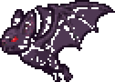

# Enemies

> Generated by `npm run design` from `src/`. Do not edit; change the data and regenerate.

16 enemy types. "Scaled" is the final stat in each zone (base × HP_BASE 4 × zone tier); elites ×2.8 HP, ×1.4 ATK, ×3 XP.

|  | id | name | behaviour | zones | base HP/ATK/DEF | speed | aggro | windup | XP | stones | drops |
|---|---|---|---|---|---|---|---|---|---|---|---|
|  | wolf | Spirit Wolf | rusher | bamboo | 40/8/1 | 58 | 110 | 0.3 | 12 | 1–3 | hp-potion 12% |
|  | snake | Jade Serpent | rusher | bamboo, marsh | 28/7/0 | 44 | 90 | 0.28 | 9 | 1–2 | hp-potion 10% |
|  | foxfire | Foxfire Wisp | caster | bamboo | 22/10/0 | 40 | 130 | – | 16 | 2–4 | mana-potion 25% |
|  | treant | Elder Treant | charger | bamboo | 110/13/5 | 26 | 100 | 0.7 | 35 | 4–8 | qi-pill 30%, hp-potion 40% |
|  | toad | Marsh Toad | rusher | marsh | 64/9/3 | 30 | 90 | 0.42 | 18 | 2–4 | hp-potion 20% |
|  | waterghost | Drowned Ghost | rusher | marsh | 34/9/0 | 36 | 120 | 0.3 | 17 | 2–4 | mana-potion 25% |
|  | ghost | Lantern Ghost | caster | marsh | 26/11/0 | 38 | 130 | – | 20 | 2–5 | mana-potion 30%, qi-pill 10% |
|  | peachspirit | Peach Spirit | caster | grove | 30/10/0 | 36 | 130 | – | 20 | 2–5 | mana-potion 30%, qi-pill 12% |
|  | bat | Cave Bat | rusher | grove | 26/6/0 | 78 | 130 | 0.24 | 8 | 1–2 | – |
|  | paperdoll | Paper Doll | rusher | grove | 26/8/0 | 52 | 100 | 0.3 | 11 | 1–2 | hp-potion 10% |
|  | swordspirit | Sword Spirit | charger | grove | 34/12/1 | 40 | 130 | 0.45 | 24 | 3–6 | qi-pill 20% |
|  | thunderbird | Thunder Bird | caster | grove | 40/13/1 | 44 | 150 | – | 34 | 4–8 | qi-pill 30%, mana-potion 30% |
|  | skeleton | Bone Soldier | rusher | ruins | 46/10/2 | 42 | 110 | 0.3 | 20 | 2–5 | hp-potion 20% |
|  | jiangshi | Jiangshi | charger | ruins | 62/13/3 | 34 | 110 | 0.6 | 30 | 3–7 | qi-pill 25% |
|  | soldier | Fallen Guard | rusher | ruins | 56/11/4 | 40 | 110 | 0.36 | 24 | 3–6 | hp-potion 25% |
|  | golem | Stone Golem | charger | ruins | 110/16/8 | 24 | 100 | 0.8 | 48 | 6–12 | qi-pill 35%, hp-potion 40% |

## Scaled stats (normal / elite)

| enemy | zone | HP | ATK | DEF | XP | stones |
|---|---|---|---|---|---|---|
| Spirit Wolf | bamboo | 160 / 448 | 10 / 13 | 1 | 12 / 36 | 1–3 |
| Jade Serpent | bamboo | 112 / 314 | 8 / 12 | 0 | 9 / 27 | 1–2 |
| Jade Serpent | marsh | 168 / 470 | 11 / 15 | 0 | 16 / 49 | 2–4 |
| Foxfire Wisp | bamboo | 88 / 246 | 12 / 17 | 0 | 16 / 48 | 2–4 |
| Elder Treant | bamboo | 440 / 1232 | 16 / 22 | 5 | 35 / 105 | 4–8 |
| Marsh Toad | marsh | 384 / 1075 | 14 / 19 | 4 | 32 / 97 | 4–7 |
| Drowned Ghost | marsh | 204 / 571 | 14 / 19 | 0 | 31 / 92 | 4–7 |
| Lantern Ghost | marsh | 156 / 437 | 17 / 23 | 0 | 36 / 108 | 4–9 |
| Peach Spirit | grove | 276 / 773 | 19 / 27 | 0 | 56 / 168 | 6–14 |
| Cave Bat | grove | 239 / 670 | 11 / 16 | 0 | 22 / 67 | 3–6 |
| Paper Doll | grove | 239 / 670 | 15 / 21 | 0 | 31 / 92 | 3–6 |
| Sword Spirit | grove | 313 / 876 | 23 / 32 | 2 | 67 / 202 | 8–17 |
| Thunder Bird | grove | 368 / 1030 | 25 / 35 | 2 | 95 / 286 | 11–22 |
| Bone Soldier | ruins | 552 / 1546 | 24 / 34 | 4 | 80 / 240 | 8–20 |
| Jiangshi | ruins | 744 / 2083 | 31 / 44 | 6 | 120 / 360 | 12–28 |
| Fallen Guard | ruins | 672 / 1882 | 26 / 37 | 8 | 96 / 288 | 12–24 |
| Stone Golem | ruins | 1320 / 3696 | 38 / 54 | 16 | 192 / 576 | 24–48 |
