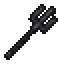
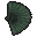
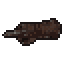
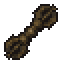
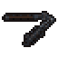
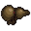
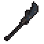
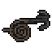
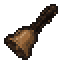
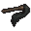

# Items, drops, shop and alchemy

> Generated by `npm run design` from `src/`. Do not edit; change the data and regenerate.

96 items. Selling pays 40% of value.

|  | id | name | type | rarity | effect | value | shop | sell | sources |
|---|---|---|---|---|---|---|---|---|---|
|  | hp-potion | Vitality Draught | consumable | common | Restores 40 HP. | 12 | 12 | 4 | wolf, snake, treant, toad, paperdoll, skeleton, soldier, golem, frostwolf, icesnake, ashskeleton, ashguard, alphawolf, s1-driftwood, s1-basaltgolem, s1-direwolf, s2-glacierwolf, s2-mawserpent, s2-rimesentinel, dunejackal, cindermoth, cloudserpent, quest:pests, quest:fox, quest:jiaolong, quest:toads, quest:furnace, quest:s1-ferry, quest:s1-denhunt, brew:brew-hp, shop |
|  | mana-potion | Clarity Draught | consumable | common | Restores 30 mana. | 12 | 12 | 4 | foxfire, waterghost, ghost, peachspirit, thunderbird, frostwisp, s1-pearlwisp, s1-tidemaiden, s1-stormhawk, s2-howlwraith, quest:jiaolong, quest:s1-hawks, brew:brew-mana, shop |
|  | qi-pill | Qi Gathering Pill | consumable | uncommon | Adds 60 qi. | 30 | 30 | 12 | treant, ghost, peachspirit, swordspirit, thunderbird, jiangshi, golem, snowtreant, crystalgolem, prismghost, shardbird, bloodjiangshi, warden, jiaolong, corpseking, sovereign, ninetail, swordshade, s1-tidecaller, s1-stormmatriarch, s1-driftwood, s1-stormhawk, s1-basaltgolem, s1-thunderimp, s2-rimematriarch, s2-prismsage, s2-blizzardhawk, s2-glacierbrute, s2-frozencorpse, s2-tombwraith, s2-mirrorspirit, cactuswarden, oasisnymph, claygolem, saltghoul, quest:fox, quest:warden, quest:furnace, quest:rift-scouts, quest:shard-harvest, quest:frost-elites, quest:barrow-rites, quest:s1-sanctum, quest:s2-gravewind, quest:ember-silent-roads, brew:brew-qi, shop |
|  | spirit-herb | Spirit Herb | quest | common | A faintly glowing lingzhi. Used in alchemy and by the elder. | 15 | – | 6 | gather@herb nodes |
|  | foundation-pill | Foundation Pill | material | rare | Required to attempt a breakthrough (B). Brew it with Alchemist Yun. | 150 | 150 | 60 | brew:brew-foundation, shop |
|  | cloth-robe | Disciple Cloth Robe | armor | common | +3 defence, +12 HP. | 50 | 50 | 20 | elite@bamboo, elite@lake, shop |
|  | sect-robe | Azure Cloud Sect Robe | armor | uncommon | +7 defence, +30 HP. | 170 | 170 | 68 | elite@marsh, elite@grove, elite@s1-pearlgrotto, shop |
|  | spirit-silk | Spirit-Silk Vestments | armor | rare | +12 defence, +55 HP. | 520 | – | 208 | swordshade, elite@ruins, elite@cliffs, elite@swordsanctum, elite@s1-stormroost |
|  | immortal-mantle | Immortal's Mantle | armor | epic | +18 defence, +95 HP. | 1100 | – | 440 | warden |
|  | jade-pendant | Jade Pendant | charm | uncommon | +6% critical chance. | 140 | 140 | 56 | elite@marsh, elite@grove, elite@wolfden, shop |
|  | spirit-ring | Spirit Ring | charm | uncommon | +25 mana, +1.5 mana regeneration. | 150 | 150 | 60 | ninetail, elite@grove, elite@lake, elite@s1-pearlgrotto, shop |
|  | tiger-fang | Tiger-Fang Charm | charm | rare | +5 attack, +4% critical chance. | 420 | – | 168 | elite@ruins, elite@cliffs, elite@swordsanctum, elite@s1-stormroost, quest:champions |
|  | dragon-pearl | Jiao Dragon Pearl | charm | epic | +40 mana, +2.5 mana regeneration, +6 defence. | 800 | – | 320 | jiaolong |
|  | dragon-scale-robe | Dragon-Scale Robe | armor | rare | +14 defence, +70 HP. | 700 | – | 280 | jiaolong |
|  | bronze-blade | Bronze Blade | weapon | common | +3 attack. | 60 | 60 | 24 | elite@bamboo, elite@lake, shop |
|  | iron-sword | Iron Sword | weapon | common | +4 attack. | 80 | – | 32 | quest:pests |
|  | steel-blade | Cold-Forged Steel Blade | weapon | uncommon | +7 attack. | 180 | 180 | 72 | alphawolf, elite@marsh, elite@ruins, elite@cliffs, elite@wolfden, quest:fox, shop |
|  | spirit-saber | Foxfire Spirit Saber | weapon | rare | +11 attack. Warm to the touch. | 600 | – | 240 | ninetail |
|  | jade-sword | Fallen Immortal's Jade Blade | weapon | epic | +15 attack. | 1200 | – | 480 | warden |
|  | greater-hp-potion | Greater Vitality Draught | consumable | uncommon | Restores 120 HP. | 40 | – | 16 | frostwolf, snowtreant, ashskeleton, bloodjiangshi, ashguard, corpseking, s2-bonewarden, s2-glacierwolf, s2-glacierbrute, s2-glasspuppet, s2-rimesentinel, sandviper, dunejackal, glassscorpion, reedtoad, duneraider, brinecrawler, saltsoldier, slagtoad, cinderhound, elite@frostpass, elite@tundra, elite@s2-rimeheart, elite@dunes, quest:rift-scouts, quest:barrow-rites, quest:hollow-heart, quest:sundered-sovereign, quest:s1-stormroost, quest:s2-trapper, quest:s2-gravewind, quest:s2-survey, quest:ember-silent-roads, quest:ember-viper-fangs, quest:ember-oasis-herbs |
|  | greater-mana-potion | Greater Clarity Draught | consumable | uncommon | Restores 80 mana. | 40 | – | 16 | frostwisp, crystalgolem, prismghost, shardbird, crystalcolossus, s2-howlwraith, s2-blizzardhawk, s2-aurorawisp, s2-tombwraith, s2-mirrorspirit, dustwisp, drownedcaravaneer, oasisnymph, ashroc, mirageghost, magmasprite, quest:shard-harvest, quest:frost-elites, quest:hollow-heart, quest:sundered-sovereign, quest:s2-trapper, quest:s2-mirror, quest:ember-roc-hunt |
|  | froststeel-blade | Froststeel Blade | weapon | rare | +19 attack. Cold enough to numb the hand. | 1500 | – | 600 | elite@frostpass, elite@crystal, elite@barrow, elite@glaciermaw, elite@tundra, elite@s2-rimeheart |
|  | crystal-saber | Heart-of-the-Hollow Saber | weapon | epic | +24 attack. | 2400 | – | 960 | crystalcolossus |
|  | sovereign-blade | Blade of the Sundered Sky | weapon | epic | +30 attack. | 4000 | – | 1600 | sovereign |
|  | frost-mail | Outpost Frost Mail | armor | rare | +22 defence, +120 HP. | 1400 | – | 560 | elite@frostpass, elite@crystal, elite@barrow, elite@glaciermaw, elite@tundra, elite@s2-gravewind, elite@s2-wyrmden |
|  | crystal-robe | Crystalweave Robe | armor | epic | +28 defence, +165 HP. | 2600 | – | 1040 | crystalcolossus |
|  | barrow-ward | Barrow-King Ward | charm | rare | +8 attack, +6% critical chance. | 1800 | – | 720 | corpseking, elite@crystal, elite@barrow, elite@glaciermaw, elite@s2-gravewind, elite@s2-mirrorvault |
|  | sky-seal | Seal of the Sundered Sky | charm | epic | +60 mana, +4 mana regeneration, +10 defence. | 3600 | – | 1440 | sovereign |
|  | ember-blade | Cinderforged Blade | weapon | rare | +36 attack. Still warm from the dunes. | 3000 | – | 1200 | elite@dunes, elite@canyon |
|  | ember-mail | Dune-Wrapped Mail | armor | rare | +32 defence, +160 HP. Sand-glass plates over desert silk. | 2800 | – | 1120 | elite@oasis, elite@canyon, elite@saltflats |
|  | furnace-saber | Saber of the Heavenly Furnace | weapon | epic | +46 attack. Quenched in the immortals' forge. | 6400 | – | 2560 | furnacewarden |
|  | furnace-robe | Furnace-Warden Vestments | armor | epic | +40 defence, +230 HP. Woven from cooled slag-silk. | 6000 | – | 2400 | mirageempress |
|  | furnace-seal | Seal of the Furnace | charm | epic | +12 attack, +7% critical chance. It hums like a kettle. | 6200 | – | 2480 | furnacewarden, elite@orchard |
|  | jade-blade | Terrace Jade Blade | weapon | rare | +52 attack. Light as a falling petal. | 5000 | – | 2000 | elite@orchard, elite@mirror, elite@stair |
|  | jade-mail | Cloudscale Armor | armor | rare | +46 defence, +220 HP. Scales shed by a celestial carp. | 4600 | – | 1840 | elite@orchard, elite@mirror, elite@stair, elite@storm |
|  | heaven-sword | Sword of the Nine Clouds | weapon | epic | +62 attack. It cuts the wind itself. | 10400 | – | 4160 | magistrate |
|  | heaven-robe | Robe of the Celestial Court | armor | epic | +56 defence, +320 HP. The hem never touches the ground. | 9800 | – | 3920 | archivekeeper |
|  | jade-seal | Seal of the Jade Magistrate | charm | epic | +18 attack, +8% critical chance, +80 mana. Cold and exact. | 10000 | – | 4000 | magistrate |
|  | abyss-blade | Bloodtempered Blade | weapon | rare | +70 attack. It remembers every hand that held it. | 8200 | – | 3280 | elite@abyss-blades, elite@abyss-basin, elite@abyss-mirror |
|  | abyss-mail | Ashen Penitent Plate | armor | rare | +64 defence, +330 HP. Heavy with other people's regret. | 7600 | – | 3040 | elite@abyss-blades, elite@abyss-basin, elite@abyss-mirror, elite@abyss-bonewood |
|  | tribulation-sword | Blade of the Third Tribulation | weapon | epic | +82 attack. Lightning sleeps in the edge. | 17000 | – | 6800 | abyss-daodemon |
|  | tribulation-robe | Robe of Nine Tribulations | armor | epic | +76 defence, +450 HP. Scorched, and stronger for it. | 16000 | – | 6400 | abyss-tyrant |
|  | abyss-seal | Seal of the Dao Demon | charm | epic | +26 attack, +10% critical chance, +14 defence. It watches back. | 16500 | – | 6600 | abyss-daodemon |
|  | s1-lotus-draught | Lotus Draught | consumable | uncommon | Restores 70 HP. | 20 | – | 8 | s1-tidecaller, s1-tidemaiden, quest:s1-grotto |
|  | s1-mist-tonic | Mist Tonic | consumable | uncommon | Restores 55 mana. | 20 | – | 8 | s1-pearlwisp, quest:s1-ferry, quest:s1-sanctum |
|  | s1-storm-pill | Stormcharged Pill | consumable | uncommon | Adds 100 qi. | 50 | – | 20 | s1-stormmatriarch, s1-thunderimp, quest:s1-hawks |
|  | s1-moonfang-cloak | Moonfang Pelt Cloak | armor | rare | +10 defence, +48 HP. | 420 | – | 168 | alphawolf, elite@wolfden, quest:s1-denhunt |
|  | s1-tidepearl | Tidepearl Pendant | charm | rare | +35 mana, +2 mana regeneration, +4 defence. | 500 | – | 200 | s1-tidecaller, elite@lake, elite@s1-pearlgrotto, quest:s1-grotto |
|  | s1-stormcaller-saber | Stormcaller Saber | weapon | rare | +13 attack. It hums before rain. | 900 | – | 360 | s1-stormmatriarch, elite@cliffs, elite@s1-stormroost, quest:s1-stormroost |
|  | s1-discipline-seal | Disciple's Sword Seal | charm | rare | +4 attack, +5% critical chance. | 650 | – | 260 | swordshade, elite@swordsanctum, quest:s1-sanctum |
|  | s2-rime-elixir | Rime Elixir | consumable | rare | Restores 200 HP. | 70 | – | 28 | s2-rimematriarch, s2-glacierwyrm, quest:s2-rimeheart |
|  | s2-aurora-draught | Aurora Draught | consumable | rare | Restores 140 mana. | 70 | – | 28 | s2-prismsage, s2-aurorawisp, quest:s2-survey, quest:s2-wyrm, quest:s2-mirror |
|  | s2-frostlotus-pill | Frostlotus Pill | consumable | rare | Adds 150 qi. | 80 | – | 32 | s2-bonewarden, s2-frozencorpse, quest:s2-bonewarden |
|  | s2-glacier-saber | Glacier Wyrm Saber | weapon | rare | +22 attack. The edge never thaws. | 1900 | – | 760 | s2-glacierwyrm, elite@glaciermaw, elite@s2-mirrorvault, elite@s2-wyrmden, quest:s2-wyrm |
|  | s2-mirror-blade | Mirrorvault Blade | weapon | epic | +26 attack. It shows you what you will do next. | 3000 | – | 1200 | s2-prismsage |
|  | s2-rime-cloak | Rime Matriarch Cloak | armor | rare | +25 defence, +140 HP. | 2000 | – | 800 | s2-rimematriarch, elite@tundra, elite@s2-rimeheart, quest:s2-rimeheart |
|  | s2-warden-signet | Bone Warden Signet | charm | rare | +6 attack, +5% critical chance, +4 defence. | 1500 | – | 600 | s2-bonewarden, elite@s2-gravewind, quest:s2-bonewarden |
|  | s2-wyrm-pearl | Glacier Wyrm Pearl | charm | epic | +50 mana, +3 mana regeneration, +8 defence. | 2800 | – | 1120 | s2-glacierwyrm, elite@s2-mirrorvault, elite@s2-wyrmden |
|  | ember-hp-potion | Sunfire Elixir | consumable | rare | Restores 300 HP. | 90 | – | 36 | cactuswarden, claygolem, duneraider, saltghoul, saltsoldier, slagtoad, cinderhound, mummy, templeguard, homunculus, sandwyrm, glasswormqueen, vaultwarden, elite@dunes, elite@oasis, quest:ember-wyrm, quest:ember-champions, quest:ember-rift-survey, quest:ember-mirage, quest:ember-furnace, quest:ember-worm-queen, quest:ember-roc-hunt, quest:ember-obsidian, quest:ember-mine-heart, quest:ember-sun-scrolls |
|  | ember-mana-potion | Moonwell Elixir | consumable | rare | Restores 160 mana. | 90 | – | 36 | mirageghost, magmasprite, vaultwisp, mirageempress, obsidiancolossus, elite@oasis, quest:ember-wyrm, quest:ember-rift-survey, quest:ember-furnace, quest:ember-oasis-herbs, quest:ember-salt-road, quest:ember-vault-seal, quest:ember-sun-scrolls |
|  | ember-qi-pill | Cinder Qi Pill | consumable | rare | Adds 180 qi. | 100 | – | 40 | obsidiangolem, sunhusk, sunblade, vaultblade, bronzeguardian, sandwyrm, mirageempress, furnacewarden, vaultwarden, quest:ember-champions, quest:ember-mirage, quest:ember-furnace, quest:ember-worm-queen, quest:ember-obsidian, quest:ember-salt-road, quest:ember-vault-seal |
|  | ember-viper-fang | Sand Viper Fang | quest | uncommon | A hooked yellow fang. Caravan guards pay for these. | 20 | – | 8 | sandviper |
|  | ember-roc-feather | Ash Roc Feather | quest | uncommon | Grey as cold ash, and stiff as wire. | 24 | – | 9 | ashroc |
|  | ember-obsidian-shard | Obsidian Shard | quest | uncommon | Black glass that stays warm in the hand. | 26 | – | 10 | obsidiangolem, bronzeguardian, obsidiancolossus |
|  | ember-sun-tablet | Sun Tablet Fragment | quest | uncommon | A gilded scrap of the temple's record. | 30 | – | 12 | mummy, sunhusk, templeguard |
|  | ember-glass-shard | Dune-Glass Shard | quest | uncommon | Green glass fused from sand. It rings when struck. | 22 | – | 8 | glassscorpion, drownedcaravaneer, glasswormling, glasswormqueen |
|  | ember-glassblade | Glass-Worm Fang Blade | weapon | epic | +41 attack. Cut from the Queen's own fang. | 4200 | – | 1680 | elite@saltflats, elite@magmarift, elite@suntemple |
|  | ember-obsidian-plate | Obsidian Miner's Plate | armor | epic | +36 defence, +190 HP. | 4400 | – | 1760 | elite@magmarift, elite@suntemple, quest:ember-mine-heart |
|  | ember-wyrm-scale | Sand Wyrm Scale | charm | epic | +7 attack, +5% critical chance, +6 defence. | 4000 | – | 1600 | sandwyrm, elite@canyon, elite@magmarift |
|  | ember-vault-sigil | Vault Alchemist's Sigil | charm | epic | +90 mana, +5 mana regeneration, +8 defence. | 4300 | – | 1720 | elite@saltflats, elite@suntemple |
|  | jade-hp-potion | Celestial Vitality Draught | consumable | uncommon | Restores 320 HP. | 90 | – | 36 | jadesentinel, oregolem, stormhound, cloudhound, celestialguard, blossomtreant, mirrorknight, cloudwyrm, quest:jade-ascent, quest:jade-storm-lord, quest:jade-lake-lanterns, quest:jade-stair-toll, quest:jade-cavern-echo, quest:jade-moon-echo |
|  | jade-mana-potion | Celestial Clarity Draught | consumable | uncommon | Restores 200 mana. | 90 | – | 36 | stormcrane, scrollwraith, inkwisp, blossomsprite, mirrorwraith, moonwisp, quest:jade-ascent, quest:jade-archive-keeper, quest:jade-peach-wine, quest:jade-lost-slips, quest:jade-vault-key |
|  | jade-pill | Nine-Cloud Qi Pill | consumable | rare | Adds 180 qi. | 120 | – | 48 | jadecolossus, scribe, celestialguard, skyblade, vaultcalligrapher, quest:jade-storm-lord, quest:jade-magistrate, quest:jade-lake-lanterns, quest:jade-cavern-echo, quest:jade-lost-slips, quest:jade-crane-feathers, quest:jade-mine-dust |
|  | jade-elixir | Peach-Blossom Elixir | consumable | rare | Restores 700 HP. | 260 | – | 104 | cranelord, archivekeeper, magistrate, mirrorqueen, quest:jade-archive-keeper, quest:jade-magistrate, quest:jade-peach-wine, quest:jade-stair-toll, quest:jade-vault-key, quest:jade-crane-feathers, quest:jade-mine-dust, quest:jade-moon-echo |
|  | jade-ore | Raw Jade Ore | material | uncommon | Heavy, cold, faintly singing. The mine-masters pay well for it. | 60 | – | 24 | jadesentinel, jadecolossus, oregolem, veinbat, seamtyrant |
|  | jade-peach | Heavenly Peach | quest | uncommon | A peach that ripened in the thin air. It smells of rain. | 40 | – | 16 | blossomsprite, blossomtreant |
|  | jade-slip-scrap | Charred Jade Slip | quest | uncommon | A scrap of a scripture, scorched by furnace smoke. | 40 | – | 16 | scrollwraith, inkwisp, scribe |
|  | jade-feather | Storm Crane Feather | quest | uncommon | White, crackling with static. | 40 | – | 16 | stormcrane |
|  | jade-crane-saber | Saber of the Crane Lord | weapon | epic | +56 attack. It hums before thunder. | 7600 | – | 3040 | cranelord, elite@storm, elite@crane, elite@library |
|  | jade-miner-plate | Seamdeep Miner's Plate | armor | epic | +49 defence, +250 HP. Jade dust in every joint. | 7000 | – | 2800 | seamtyrant, elite@stair, elite@crane |
|  | jade-vault-robe | Vault-Scribe Robe | armor | epic | +51 defence, +270 HP. Sewn with sealed verses. | 8000 | – | 3200 | vaultcalligrapher, elite@library |
|  | jade-wyrm-pearl | Cloudwyrm Pearl | charm | epic | +60 mana, +3 mana regeneration, +12 defence. | 6000 | – | 2400 | cloudwyrm, elite@mirror, elite@crane |
|  | jade-moon-pendant | Moon-Mirror Pendant | charm | epic | +10 attack, +6% critical chance, +50 mana. | 7200 | – | 2880 | mirrorqueen, elite@storm, elite@library |
|  | abyss-hp-potion | Crimson Lotus Draught | consumable | rare | Restores 450 HP. | 90 | – | 36 | abyss-bladewraith, abyss-ashknight, abyss-lavatoad, abyss-hollowserpent, abyss-cindergolem, abyss-effigy, abyss-bonehound, abyss-tyrant, abyss-rootking, elite@abyss-blades, quest:abyss-first-flame, quest:abyss-blood-river, quest:abyss-ash-trial, quest:abyss-dao-demon, quest:abyss-sword-grave, quest:abyss-ferry-fire, quest:abyss-bone-ledger, quest:abyss-slag-and-ash, quest:abyss-bone-cavern-delve |
|  | abyss-mana-potion | Draught of Still Water | consumable | rare | Restores 220 mana. | 90 | – | 36 | abyss-regretghost, abyss-bloodfoxfire, abyss-emberbird, abyss-mirrorshade, abyss-witheredpeach, abyss-springfox, quest:abyss-first-flame, quest:abyss-mirror-truth, quest:abyss-ash-trial, quest:abyss-ferry-fire, quest:abyss-vault-selves, quest:abyss-ash-whispers |
|  | abyss-qi-pill | Tribulation Qi Pill | consumable | rare | Adds 240 qi. | 110 | – | 44 | abyss-bloodfoxfire, abyss-emberbird, abyss-bonetreant, abyss-penitent, abyss-matron, quest:abyss-mirror-truth, quest:abyss-matron, quest:abyss-dao-demon, quest:abyss-sword-grave, quest:abyss-grotto-spring, quest:abyss-ash-whispers, quest:abyss-regret-letters, quest:abyss-reliquary-delve |
|  | abyss-heal-pill | Deathless Pill | consumable | epic | Restores 1000 HP. Said to have been refined from a promise. | 260 | – | 104 | abyss-cindergolem, abyss-bonetreant, abyss-penitent, abyss-tyrant, abyss-matron, abyss-daodemon, abyss-vaultself, abyss-cinderwarden, quest:abyss-blood-river, quest:abyss-matron, quest:abyss-ash-trial, quest:abyss-dao-demon, quest:abyss-grotto-spring, quest:abyss-vault-selves, quest:abyss-bone-ledger, quest:abyss-regret-letters, quest:abyss-slag-and-ash, quest:abyss-bone-cavern-delve, quest:abyss-reliquary-delve |
|  | abyss-blade-shard | Unburied Blade Shard | material | uncommon | A splinter of a sword nobody came back for. | 40 | – | 16 | abyss-bladewraith |
|  | abyss-bone-root | Bone Root | material | uncommon | White, damp and faintly warm. | 40 | – | 16 | abyss-bonetreant, abyss-bonehound, abyss-penitent |
|  | abyss-mirror-shard | Mirror Shard | material | uncommon | It shows you slightly younger. | 40 | – | 16 | abyss-mirrorshade, abyss-effigy |
|  | abyss-regret-bloom | Regret Bloom | material | uncommon | A petal that never finished falling. | 40 | – | 16 | abyss-regretghost, abyss-witheredpeach |
|  | abyss-ash-ore | Reliquary Ash Ore | material | uncommon | Ash that remembers being a name. | 40 | – | 16 | abyss-ashmoth, abyss-ashknight, abyss-cindergolem |
|  | abyss-bonefang | Ossuary Fang | weapon | epic | +76 attack. Grown, not forged. | 11000 | – | 4400 | abyss-rootking, elite@abyss-bonewood, elite@abyss-ash, elite@abyss-regret |
|  | abyss-veil-robe | Veil of Past Selves | armor | epic | +70 defence, +390 HP. It fits better than it should. | 10400 | – | 4160 | abyss-vaultself, elite@abyss-mirror, elite@abyss-ash, elite@abyss-regret |
|  | abyss-ember-ring | Ring of the Blood Spring | charm | epic | +14 attack, +9 defence, +4 mana regeneration. | 9000 | – | 3600 | abyss-springfox, elite@abyss-basin, elite@abyss-ash |
|  | abyss-bone-charm | Reliquary Bone Charm | charm | epic | +18 attack, +7% critical chance, +60 mana. | 12000 | – | 4800 | abyss-matron, abyss-cinderwarden, elite@abyss-bonewood, elite@abyss-regret |

## Alchemy recipes

| id | name | output | herbs | stones | note |
|---|---|---|---|---|---|
| brew-hp | Vitality Draught | hp-potion | 1 | 3 | Restores 40 HP |
| brew-mana | Clarity Draught | mana-potion | 1 | 3 | Restores 30 mana |
| brew-foundation | Foundation Pill | foundation-pill | 3 | 25 | Needed for every breakthrough |
| brew-qi | Qi Gathering Pill | qi-pill | 2 | 8 | Adds 60 qi |
