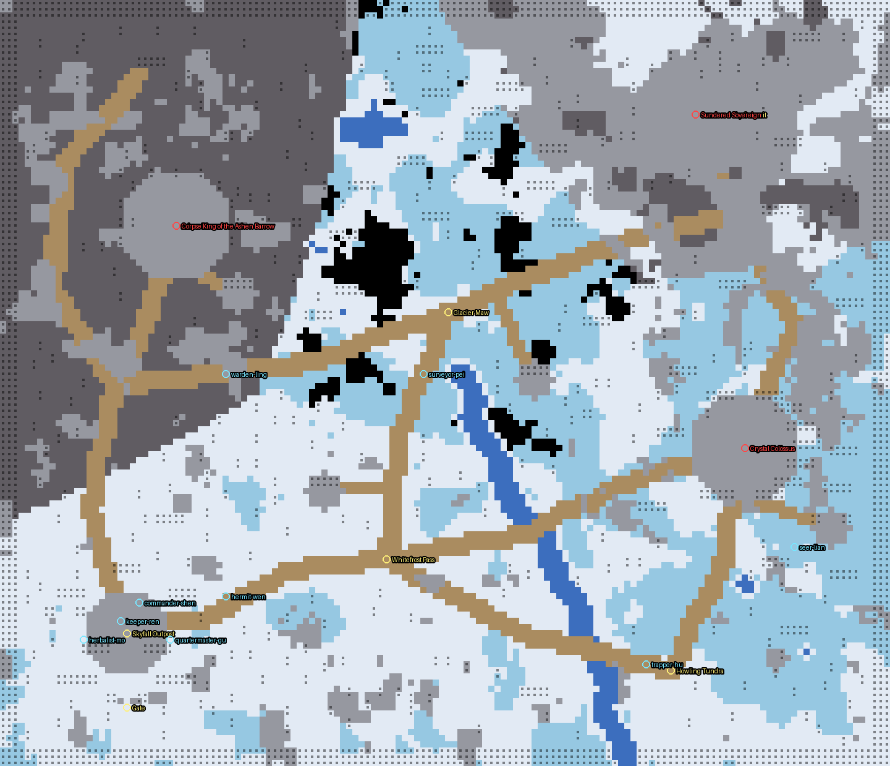
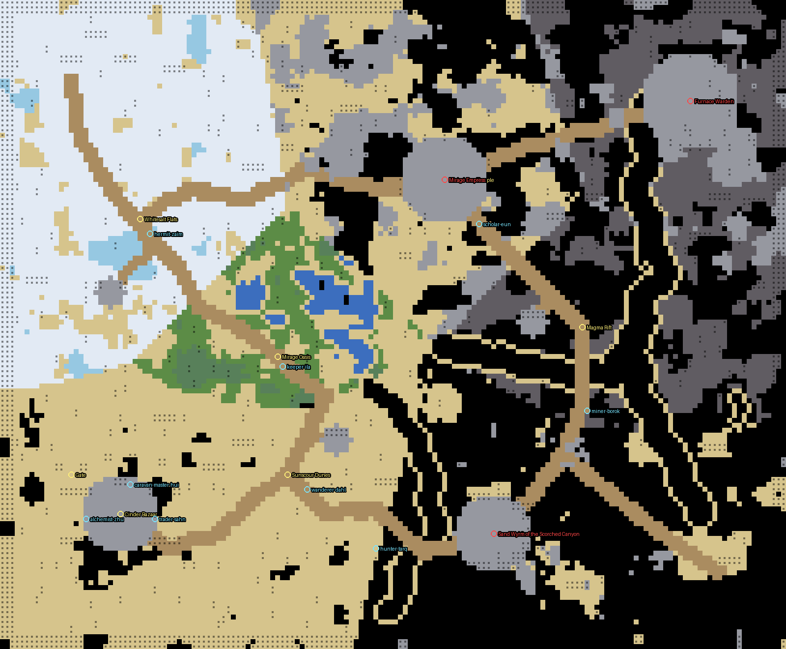
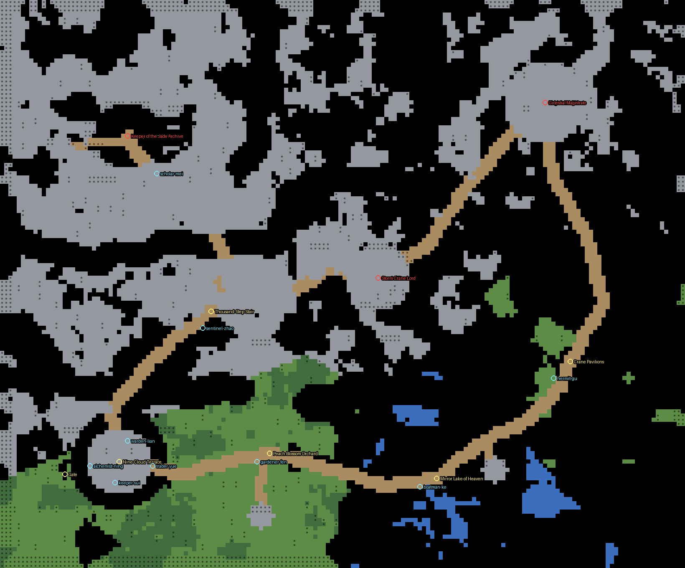
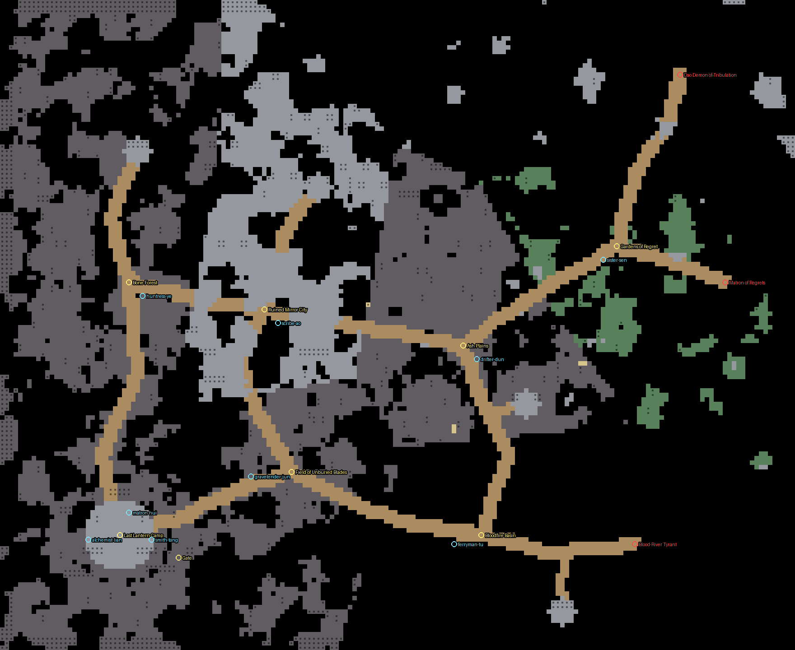

# Zones, props and world

> Generated by `npm run design` from `src/`. Do not edit; change the data and regenerate.

World seed 20261016. Chapter 1: 144×124 tiles; Chapter 2: 144×124 tiles; Chapter 3: 160×132 tiles; Chapter 4: 164×136 tiles; Chapter 5: 176×144 tiles (16 units per tile).

### Chapter 1: The Broken Seals

### Chapter 2: The Sundered Sky

### Chapter 3: The Ember Wastes

### Chapter 4: The Jade Heavens

### Chapter 5: The Crimson Abyss

## Zones

| id | chapter | name | level | mood | tier hp/atk/xp | spawns | bosses |
|---|---|---|---|---|---|---|---|
| village | 1 | Azure Cloud Sect | Safe | day | 1/1/1 | – | – |
| bamboo | 1 | Whispering Bamboo Forest | Lv 1-4 | day | 1/1.2/1 | wolf×12, snake×6, foxfire×6, treant×2 | – |
| marsh | 1 | Mistveil Marsh | Lv 3-7 | mist | 1.5/1.5/1.8 | toad×8, waterghost×6, ghost×6, snake×4 | jiaolong |
| grove | 1 | Peach Spirit Grove | Lv 5-9 | dusk | 2.3/1.9/2.8 | peachspirit×6, bat×8, paperdoll×6, swordspirit×4, thunderbird×2 | ninetail |
| ruins | 1 | Broken Sword Ruins | Lv 7-12 | night | 3/2.4/4 | skeleton×8, jiangshi×6, soldier×6, golem×4 | – |
| lair | 1 | Fallen Immortal's Court | Boss | night | 3/2.4/4 | – | warden |
| outpost | 2 | Skyfall Outpost | Safe | frost | 1/1/1 | – | – |
| frostpass | 2 | Whitefrost Pass | Lv 10-14 | frost | 4.2/3/4.2 | frostwolf×9, icesnake×4, frostwisp×4, rimebat×5, snowtreant×2 | – |
| crystal | 2 | Crystal Hollow | Lv 12-16 | frost | 4.8/3.3/5 | crystalgolem×4, prismghost×4, shardbird×3, frostwisp×3, rimebat×4 | crystalcolossus |
| barrow | 2 | Ashen Barrow | Lv 13-18 | night | 5.3/3.6/5.8 | ashskeleton×7, bloodjiangshi×4, ashguard×5, prismghost×3 | corpseking |
| summit | 2 | Sundered Sky Summit | Boss | night | 5.6/3.8/6.2 | – | sovereign |
| lake | 1 | Moonmirror Lake | Lv 2-6 | dusk | 1.25/1.35/1.4 | snake×5, waterghost×4, foxfire×3, toad×3, s1-pearlwisp×4, s1-driftwood×2, s1-tidemaiden×3 | – |
| cliffs | 1 | Thunderpeak Cliffs | Lv 8-12 | dusk | 2.7/2.2/3.4 | thunderbird×3, s1-stormhawk×4, swordspirit×3, s1-cragbat×6, s1-basaltgolem×3, s1-thunderimp×4, jiangshi×2 | – |
| glaciermaw | 2 | Glacier Maw | Lv 14-18 | frost | 5/3.4/5.4 | s2-mawserpent×6, s2-aurorawisp×5, s2-glacierbrute×4, icesnake×3, prismghost×3, rimebat×3 | – |
| tundra | 2 | Howling Tundra | Lv 12-16 | frost | 4.6/3.2/4.8 | s2-glacierwolf×7, s2-howlwraith×4, s2-blizzardhawk×4, frostwolf×4, rimebat×4, snowtreant×2 | – |
| bazaar | 3 | Cinder Bazaar | Safe | day | 1/1/1 | – | – |
| dunes | 3 | Sunscour Dunes | Lv 18-21 | day | 6/4.2/6.4 | sandviper×8, dunejackal×7, glassscorpion×5, dustwisp×4, cactuswarden×3 | – |
| oasis | 3 | Mirage Oasis | Lv 19-22 | mist | 6.4/4.5/6.9 | reedtoad×6, drownedcaravaneer×6, oasisnymph×6, dunejackal×4, sandviper×4, cactuswarden×2 | – |
| canyon | 3 | Scorched Canyon | Lv 21-24 | dusk | 6.9/4.8/7.4 | claygolem×5, ashroc×4, glassscorpion×6, duneraider×7, cindermoth×6 | sandwyrm |
| saltflats | 3 | Whitesalt Flats | Lv 22-25 | frost | 7.4/5.1/8 | saltghoul×4, mirageghost×6, brinecrawler×6, saltsoldier×7, ashroc×3 | – |
| magmarift | 3 | Magma Rift | Lv 24-27 | night | 8/5.5/8.8 | magmasprite×7, cindermoth×7, obsidiangolem×4, slagtoad×6, cinderhound×6 | – |
| suntemple | 3 | Buried Sun Temple | Lv 26-28 | dusk | 8.5/5.8/9.4 | mummy×7, sunhusk×4, templeguard×6, mirageghost×5, sunblade×3 | mirageempress |
| furnace | 3 | Furnace Summit | Boss | night | 9/6.1/10 | – | furnacewarden |
| terrace | 4 | Nine-Cloud Terrace | Safe | day | 1/1/1 | – | – |
| orchard | 4 | Peach Blossom Orchard | Lv 26-28 | dusk | 7.6/5.2/7.4 | blossomsprite×6, blossomtreant×3, cloudhound×6, jadesentinel×4, cloudserpent×4 | – |
| mirror | 4 | Mirror Lake of Heaven | Lv 28-31 | mist | 8.6/5.8/8.6 | mirrorwraith×8, cloudserpent×6, jadesentinel×4, blossomsprite×3, cloudhound×3 | – |
| stair | 4 | Thousand-Step Stair | Lv 28-31 | day | 8.9/6/8.8 | jadesentinel×7, jadecolossus×3, skyblade×6, celestialguard×4, cloudhound×3 | – |
| storm | 4 | Court of Storms | Lv 30-33 | night | 9.8/6.5/9.8 | stormcrane×7, stormhound×6, skyblade×4, jadesentinel×3, cloudserpent×3 | cranelord |
| crane | 4 | Crane Pavilions | Lv 32-35 | dusk | 10.6/7/10.6 | stormcrane×6, celestialguard×7, skyblade×5, mirrorwraith×3, cloudhound×3 | – |
| library | 4 | Library of Jade Slips | Lv 33-36 | mist | 11.6/7.6/11.6 | scrollwraith×9, inkwisp×7, jadecolossus×3, celestialguard×5, scribe×3 | archivekeeper |
| dais | 4 | Magistrate's Dais | Boss | night | 12.4/8/12.4 | – | magistrate |
| lantern | 5 | Last Lantern Camp | Safe | dusk | 1/1/1 | – | – |
| abyss-blades | 5 | Field of Unburied Blades | Lv 36-40 | night | 12/6.5/10.8 | abyss-bladewraith×9, abyss-ashmoth×6, abyss-regretghost×4, abyss-ashknight×4 | – |
| abyss-basin | 5 | Bloodfire Basin | Lv 38-42 | dusk | 13/7/12 | abyss-lavatoad×8, abyss-bloodfoxfire×6, abyss-emberbird×4, abyss-hollowserpent×5, abyss-cindergolem×2 | abyss-tyrant |
| abyss-mirror | 5 | Ruined Mirror City | Lv 39-43 | mist | 13.5/7.2/12.5 | abyss-mirrorshade×7, abyss-effigy×7, abyss-bladewraith×3, abyss-regretghost×4, abyss-ashknight×3 | – |
| abyss-bonewood | 5 | Bone Forest | Lv 40-44 | night | 14.5/7.8/13.4 | abyss-bonetreant×5, abyss-bonehound×9, abyss-penitent×3, abyss-ashmoth×5, abyss-bloodfoxfire×3 | – |
| abyss-ash | 5 | Ash Plains | Lv 41-45 | dusk | 15/8/14.2 | abyss-ashknight×8, abyss-cindergolem×4, abyss-emberbird×4, abyss-ashmoth×5, abyss-penitent×3 | – |
| abyss-regret | 5 | Gardens of Regret | Lv 43-47 | mist | 16.5/9/15.4 | abyss-regretghost×7, abyss-witheredpeach×7, abyss-penitent×4, abyss-mirrorshade×3, abyss-bonetreant×3 | abyss-matron |
| abyss-peak | 5 | Tribulation Peak | Boss | night | 17/9.5/16.8 | – | abyss-daodemon |
| wolfden | 1 | Moonfang Den | Lv 4-6 | night | 1.5/1.55/1.7 | wolf×9, s1-direwolf×6, snake×4, bat×6, foxfire×3 | alphawolf |
| swordsanctum | 1 | Hidden Sword Sanctum | Lv 8-11 | night | 3.2/2.5/4.2 | swordspirit×8, skeleton×6, soldier×5, paperdoll×5, golem×2 | swordshade |
| s1-pearlgrotto | 1 | Pearl Grotto | Lv 5-8 | mist | 1.7/1.7/2 | waterghost×6, s1-pearlwisp×6, s1-tidemaiden×4, s1-driftwood×3, toad×4 | s1-tidecaller |
| s1-stormroost | 1 | Thunderroost Cavern | Lv 9-12 | dusk | 3/2.4/3.8 | s1-stormhawk×6, s1-cragbat×6, s1-thunderimp×5, s1-basaltgolem×3, thunderbird×3 | s1-stormmatriarch |
| s2-rimeheart | 2 | Rimeheart Cave | Lv 11-14 | frost | 4.5/3.1/4.8 | frostwolf×6, s2-glacierwolf×6, icesnake×4, rimebat×5, frostwisp×3 | s2-rimematriarch |
| s2-gravewind | 2 | Gravewind Catacomb | Lv 15-18 | night | 5.4/3.7/5.9 | ashskeleton×6, s2-frozencorpse×4, s2-tombwraith×4, ashguard×4, bloodjiangshi×3 | s2-bonewarden |
| s2-mirrorvault | 2 | Mirror Vault | Lv 14-17 | frost | 5/3.5/5.6 | s2-mirrorspirit×7, s2-glasspuppet×6, s2-rimesentinel×4, prismghost×4, crystalgolem×2 | s2-prismsage |
| s2-wyrmden | 2 | Glacier Wyrm Den | Lv 16-19 | frost | 5.2/3.6/5.8 | s2-mawserpent×6, s2-aurorawisp×5, s2-glacierbrute×4, icesnake×4, prismghost×3 | s2-glacierwyrm |
| ember-burrow | 3 | Glass-Worm Burrow | Lv 19-22 | dusk | 6.6/4.6/7.4 | sandviper×7, glassscorpion×8, glasswormling×8, dustwisp×4, cactuswarden×2 | glasswormqueen |
| ember-mine | 3 | Obsidian Mine | Lv 24-27 | night | 8.2/5.5/9.2 | obsidiangolem×5, magmasprite×6, cindermoth×8, slagtoad×5, cinderhound×5 | obsidiancolossus |
| ember-vault | 3 | Sunken Alchemy Vault | Lv 25-28 | night | 8.8/5.9/10 | vaultblade×6, homunculus×8, vaultwisp×6, bronzeguardian×4 | vaultwarden |
| cloudhollow | 4 | Cloudhollow Cavern | Lv 27-30 | mist | 9.4/6.2/10 | cloudserpent×6, cloudhound×6, veinbat×7, blossomsprite×3, stormhound×3 | cloudwyrm |
| jademine | 4 | Seamdeep Jade Mine | Lv 30-33 | night | 10.8/7/12 | jadesentinel×7, oregolem×4, veinbat×8, jadecolossus×3, skyblade×3 | seamtyrant |
| scrollvault | 4 | Sealed Scripture Vault | Lv 34-37 | mist | 12.2/8/14 | scrollwraith×8, inkwisp×6, scribe×6, celestialguard×4, jadecolossus×2 | vaultcalligrapher |
| moonpalace | 4 | Palace Beneath the Moon Mirror | Lv 35-38 | frost | 13/8.4/15 | mirrorknight×7, mirrorwraith×6, moonwisp×6, echobat×6, celestialguard×3 | mirrorqueen |
| abyss-bonecavern | 5 | Bone-Root Cavern | Lv 40-44 | night | 17/8.5/16.8 | abyss-bonehound×8, abyss-bonetreant×4, abyss-ashmoth×6, abyss-penitent×3 | abyss-rootking |
| abyss-bloodgrotto | 5 | Blood-Spring Grotto | Lv 38-42 | dusk | 15.5/7.5/15.4 | abyss-lavatoad×7, abyss-bloodfoxfire×6, abyss-hollowserpent×6, abyss-emberbird×3 | abyss-springfox |
| abyss-mirrorvault | 5 | Vault of Past Selves | Lv 43-47 | mist | 19/9/19.2 | abyss-mirrorshade×8, abyss-effigy×6, abyss-regretghost×5, abyss-bladewraith×4 | abyss-vaultself |
| abyss-ashmaw | 5 | Cinder Reliquary | Lv 44-48 | dusk | 20/9.5/20.2 | abyss-ashknight×7, abyss-cindergolem×4, abyss-emberbird×4, abyss-witheredpeach×4, abyss-penitent×3 | abyss-cinderwarden |

## Props

|  | kind | scale | collision rects | flat | placed |
|---|---|---|---|---|---|
|  | pavilion | 0.3 | 1 | – | 21 |
|  | stonebridge | 0.25 | 0 | – | 0 |
|  | bamboo | 0.21 | 1 | – | 361 |
|  | pine | 0.26 | 1 | – | 533 |
|  | stairs | 0.22 | 0 | – | 12 |
|  | paifang | 0.28 | 2 | – | 4 |
|  | tower | 0.26 | 1 | – | 17 |
|  | moonwall | 0.26 | 2 | – | 23 |
|  | corridor | 0.28 | 2 | – | 4 |
|  | taihurocks | 0.24 | 1 | – | 417 |
|  | willow | 0.26 | 1 | – | 326 |
|  | lingzhi | 0.13 | 0 | – | 247 |
|  | orchid | 0.13 | 0 | – | 524 |
|  | rock | 0.18 | 1 | – | 837 |
|  | bambooshoot | 0.13 | 0 | – | 89 |
|  | lotuspond | 0.26 | 0 | yes | 2 |
|  | petals | 0.22 | 0 | yes | 184 |
|  | goldpaifang | 0.3 | 2 | – | 2 |
|  | palace | 0.34 | 1 | – | 1 |
|  | jadebridge | 0.22 | 0 | – | 7 |
|  | dragonpillar | 0.22 | 1 | – | 311 |
|  | lotusthrone | 0.26 | 1 | – | 1 |
|  | goldgate | 0.3 | 2 | – | 3 |
|  | floatisle | 0.2 | 1 | – | 3 |
|  | lotusbowl | 0.18 | 1 | – | 11 |
|  | array | 0.3 | 0 | yes | 47 |
|  | standstone | 0.26 | 1 | – | 670 |
|  | stonecircle | 0.24 | 1 | – | 17 |
|  | peachtree | 0.24 | 1 | – | 361 |
|  | pagoda7 | 0.3 | 1 | – | 8 |
