# Zones, props and world

> Generated by `npm run design` from `src/`. Do not edit; change the data and regenerate.

World seed 20261016, 80×80 tiles (16 units per tile).

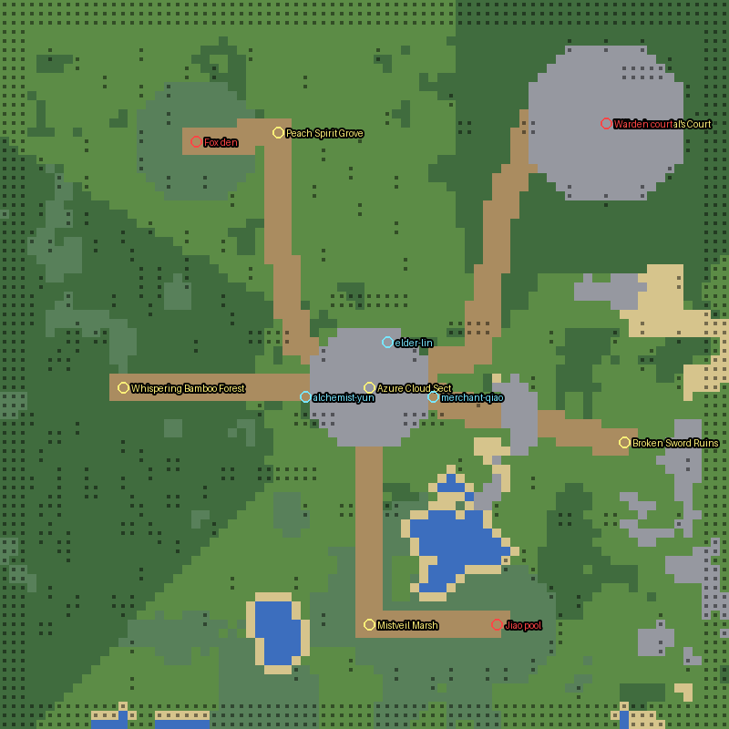

## Zones

| id | name | level | mood | tier hp/atk/xp | spawns | bosses |
|---|---|---|---|---|---|---|
| village | Azure Cloud Sect | Safe | day | 1/1/1 | – | – |
| bamboo | Whispering Bamboo Forest | Lv 1-4 | day | 1/1.2/1 | wolf×6, snake×3, foxfire×3, treant×1 | – |
| marsh | Mistveil Marsh | Lv 3-7 | mist | 1.5/1.5/1.8 | toad×4, waterghost×3, ghost×3, snake×2 | jiaolong |
| grove | Peach Spirit Grove | Lv 5-9 | dusk | 2.3/1.9/2.8 | peachspirit×3, bat×4, paperdoll×3, swordspirit×2, thunderbird×1 | ninetail |
| ruins | Broken Sword Ruins | Lv 7-12 | night | 3/2.4/4 | skeleton×4, jiangshi×3, soldier×3, golem×2 | – |
| lair | Fallen Immortal's Court | Boss | night | 3/2.4/4 | – | warden |

## Props

|  | kind | scale | collision rects | flat | placed |
|---|---|---|---|---|---|
| 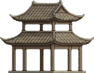 | pavilion | 0.3 | 1 | – | 1 |
|  | stonebridge | 0.25 | 0 | – | 0 |
| 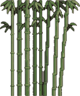 | bamboo | 0.21 | 1 | – | 113 |
| 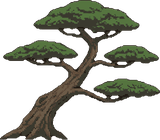 | pine | 0.26 | 1 | – | 68 |
| 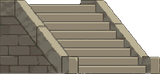 | stairs | 0.22 | 0 | – | 0 |
| 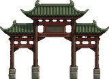 | paifang | 0.28 | 2 | – | 0 |
| 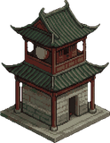 | tower | 0.26 | 1 | – | 1 |
| 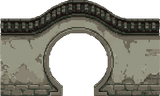 | moonwall | 0.26 | 2 | – | 1 |
| 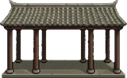 | corridor | 0.28 | 2 | – | 0 |
| 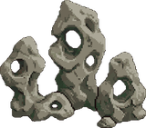 | taihurocks | 0.24 | 1 | – | 0 |
| 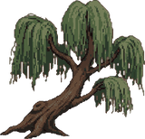 | willow | 0.26 | 1 | – | 43 |
| 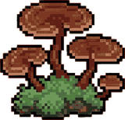 | lingzhi | 0.13 | 0 | – | 20 |
| 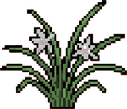 | orchid | 0.13 | 0 | – | 54 |
| 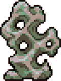 | rock | 0.18 | 1 | – | 19 |
| 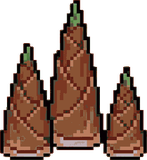 | bambooshoot | 0.13 | 0 | – | 15 |
| 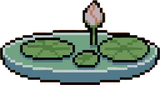 | lotuspond | 0.26 | 0 | yes | 1 |
| 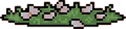 | petals | 0.22 | 0 | yes | 0 |
|  | goldpaifang | 0.3 | 2 | – | 1 |
| 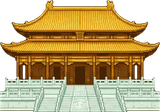 | palace | 0.34 | 1 | – | 1 |
|  | jadebridge | 0.22 | 0 | – | 0 |
| 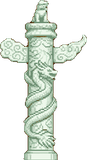 | dragonpillar | 0.22 | 1 | – | 2 |
|  | lotusthrone | 0.26 | 1 | – | 1 |
|  | goldgate | 0.3 | 2 | – | 1 |
| 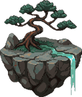 | floatisle | 0.2 | 1 | – | 0 |
| 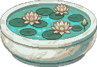 | lotusbowl | 0.18 | 1 | – | 2 |
| 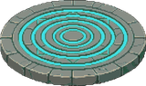 | array | 0.3 | 0 | yes | 4 |
|  | standstone | 0.26 | 1 | – | 21 |
| 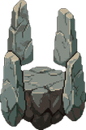 | stonecircle | 0.24 | 1 | – | 0 |
| 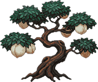 | peachtree | 0.24 | 1 | – | 64 |
| 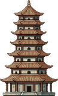 | pagoda7 | 0.3 | 1 | – | 1 |
